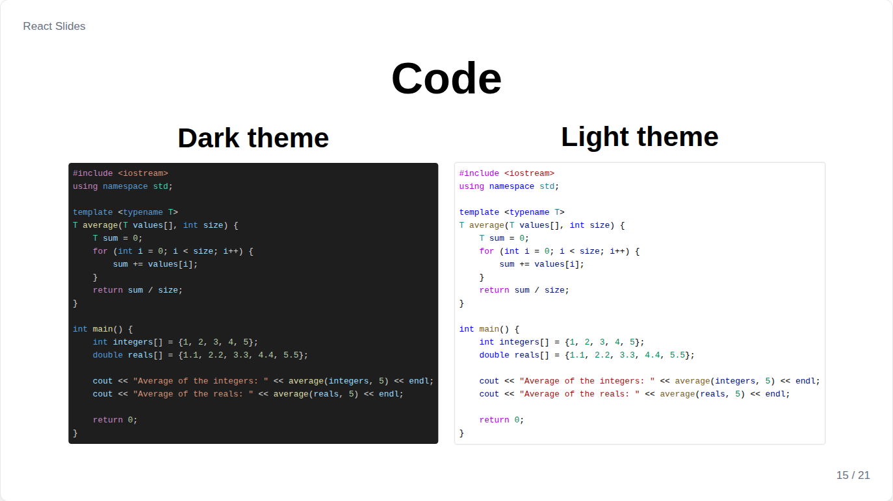
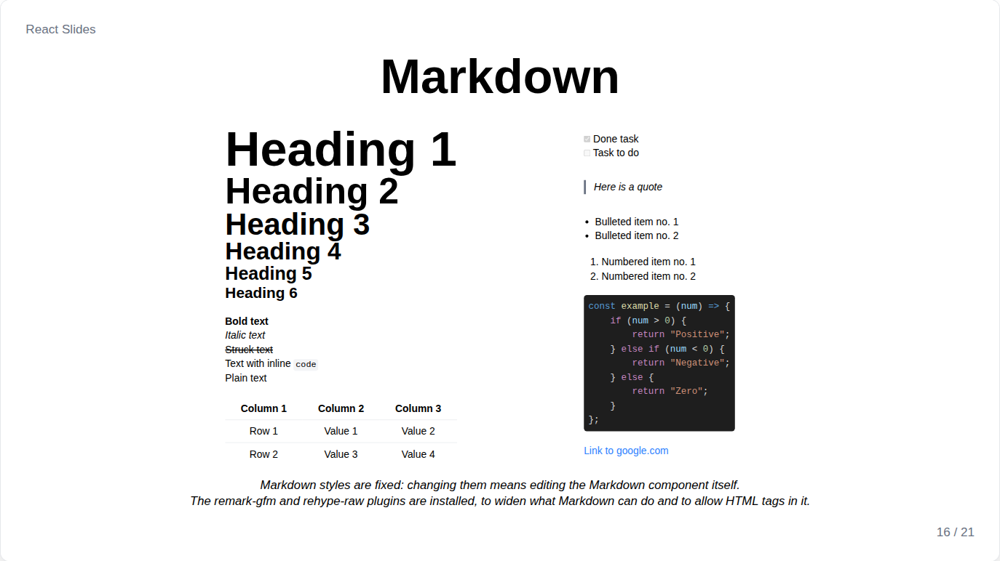

# Code and Markdown

## Code



`Code` highlights code with Shiki, the engine of VS Code:

```jsx
<Code language="python">{`print("Hello")`}</Code>
<Code language="jsx" theme="light" fontSize="2xl" align="center">{source}</Code>
```

| Prop | Default | Meaning |
| --- | --- | --- |
| `language` | none | One of the about 230 languages of Shiki, by name or alias: `js`, `ts`, `sh`, `c++`... |
| `theme` | the slide's `codeTheme` | `"dark"` or `"light"` |
| `fontSize` | `"lg"` | Size of the code |
| `align` | `left` | Position of the block |
| `font` | `mono` | Font of the code |

Each grammar is a separate file, loaded only when a slide shows that language, and the slide appears once its code is colored. An unknown language still renders, without colors.

## Markdown



`Markdown` renders Markdown with the components of the library: headings, bold, italic and struck text, lists and task lists, quotes, code blocks, links, tables, images and raw HTML.

```jsx
<Markdown>{`
## A title

Some **bold** text, and a [link](https://react.dev).
`}</Markdown>
```

An image in Markdown is imported like any other:

```jsx
import photo from '../../assets/photo.jpg';

<Markdown>{``}</Markdown>
```

A ` ```mermaid ` block becomes a [diagram](diagrams-and-formulas.md#diagram), and `$...$` and `$$...$$` become [formulas](diagrams-and-formulas.md#formula). `font` sets the font of the whole text.
