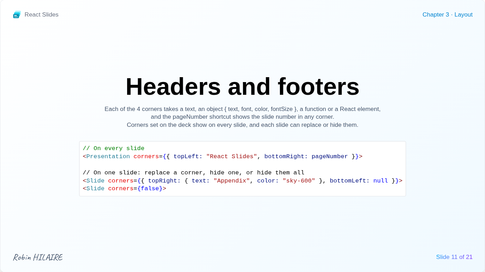

# Headers, footers and notes

## Corners



Each of the four corners of a slide, `topLeft`, `topRight`, `bottomLeft` and `bottomRight`, can hold a header or footer:

- a text;
- an object `{ text, font, color, fontSize }`;
- a function receiving the slide `number` and `total`, returning one of these;
- any React element, such as a logo.

Corners left out stay empty, and the slide content always makes room for them. `pageNumber` shows "3 / 16" in whichever corner it is placed.

```jsx
import pageNumber from '../../components/pageNumber.js';

<Presentation corners={{ topLeft: "React Slides", bottomRight: pageNumber }}>
    <Slide corners={false}><Title /></Slide>
    <Slide corners={{ topRight: { text: "Appendix", color: "sky-600" }, bottomLeft: null }}>
        <Appendix />
    </Slide>
</Presentation>
```

A slide replaces some corners, hides one with `null`, or hides them all with `false`.

## Speaker notes

`notes` on a slide gives its speaker notes, in Markdown, shown in the [notes panel](../interface/notes.md) and the [presenter view](../interface/presenter.md). Text formatting, lists, task lists, quotes, code, links, tables, formulas and diagrams are rendered; images and raw HTML are not. The common indentation of the text is removed, so it can follow the code:

```jsx
<Slide notes={`
    ## Key message

    - Start with **the question** the slide answers
    - Leave time for questions

    > Do not read the slide out loud.
`}>
    <MySlide />
</Slide>
```
