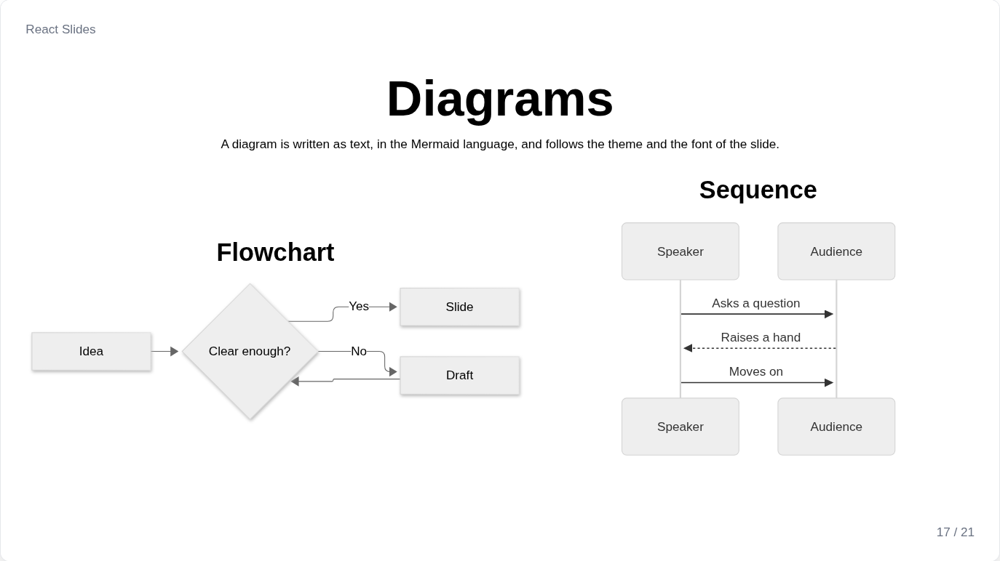
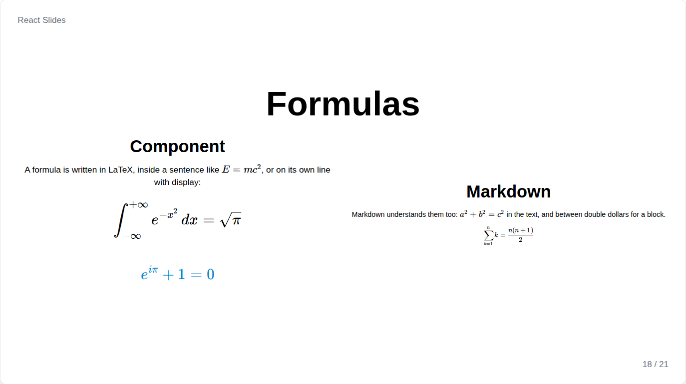

# Diagrams and formulas

Mermaid and KaTeX are separate files, loaded only by the slides that use them, and both are drawn as vectors, sharp in the PDF.

## Diagram



`Diagram` draws a diagram written in the [Mermaid](https://mermaid.js.org) language: flowcharts, sequences, classes, states, timelines, charts and every other kind Mermaid knows. The indentation of the text is removed, so it can follow the code:

```jsx
<Diagram>{`
    flowchart LR
        A[Idea] --> B{Clear enough?}
        B -- Yes --> C[Slide]
`}</Diagram>
```

| Prop | Default | Meaning |
| --- | --- | --- |
| `fontSize` | `"2xl"` | Size of its text; the whole diagram scales with it, and shrinks when its column is too narrow |
| `theme` | the slide's `diagramTheme` | `"light"`, `"dark"` or any Mermaid theme |
| `align` | `center` | Position of the diagram |
| `font` | the slide's font | Font of its text |

## Formula



`Formula` writes a formula in LaTeX with KaTeX, inside a sentence, or on its own line with `display`. A raw string avoids doubling the backslashes:

```jsx
<Paragraph>Energy <Formula>{"E = mc^2"}</Formula> comes from mass.</Paragraph>
<Formula display fontSize="4xl">{String.raw`\int_0^1 x^2\,dx = \frac{1}{3}`}</Formula>
```

`fontSize`, `color` and, with `display`, `align` work as on texts.

## In Markdown and notes

In `Markdown` and in the speaker notes, a ` ```mermaid ` block becomes a diagram, and `$...$` and `$$...$$` become formulas.
