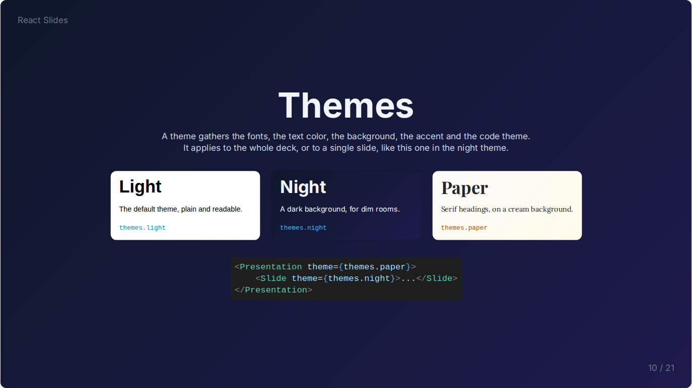

# Layouts

Layouts place content on the slide; they nest freely.

| Component | Props | Purpose |
| --- | --- | --- |
| `CenterLayout` | | Centers its content vertically and horizontally |
| `TwoColumnLayout` | `leftContent`, `rightContent` | Two contents side by side |
| `GridLayout` | `columns` (2), `gap` (8), `verticalAlign` | Its children in equal columns |
| `RowLayout` | `gap` (8), `align` (`center`), `verticalAlign` (`center`) | Its children side by side on one row |
| `Card` | `bg` (`white`) | A rounded, shadowed box around its content |
| `ColorSwatch` | `color`, `label`, `size` (`md`), `fontSize`, `labelColor`, `font` | A color or gradient sample |

`gap` follows the Tailwind scale: `gap={6}` is `1.5rem`. `align` and `verticalAlign` take `left`, `center`, `right`, `top` or `bottom`. `ColorSwatch` comes in three sizes: `fill`, the width of its column, `md` and `lg`.

```jsx
<CenterLayout>
    <Heading fontSize="8xl" align="center">Three ideas</Heading>
    <GridLayout columns={3} gap={8}>
        <Card><Paragraph>One</Paragraph></Card>
        <Card><Paragraph>Two</Paragraph></Card>
        <Card><Paragraph>Three</Paragraph></Card>
    </GridLayout>
</CenterLayout>
```

```jsx
<TwoColumnLayout
    leftContent={<Paragraph>Text on the left</Paragraph>}
    rightContent={<Image src={photo} alt="A photo" />}
/>
```


