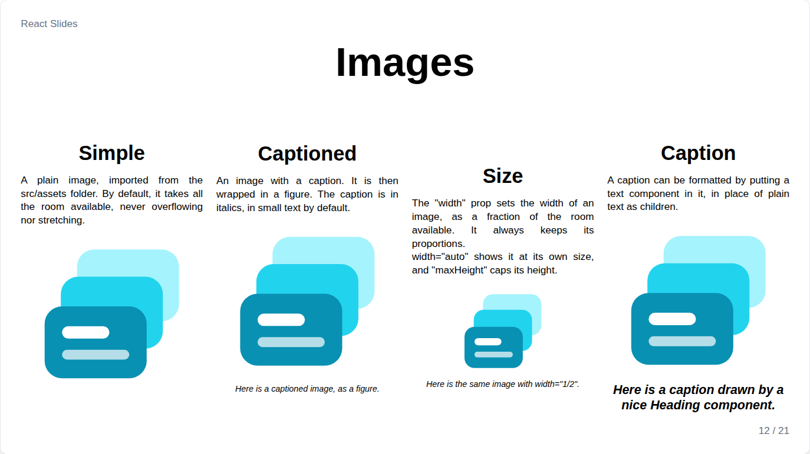
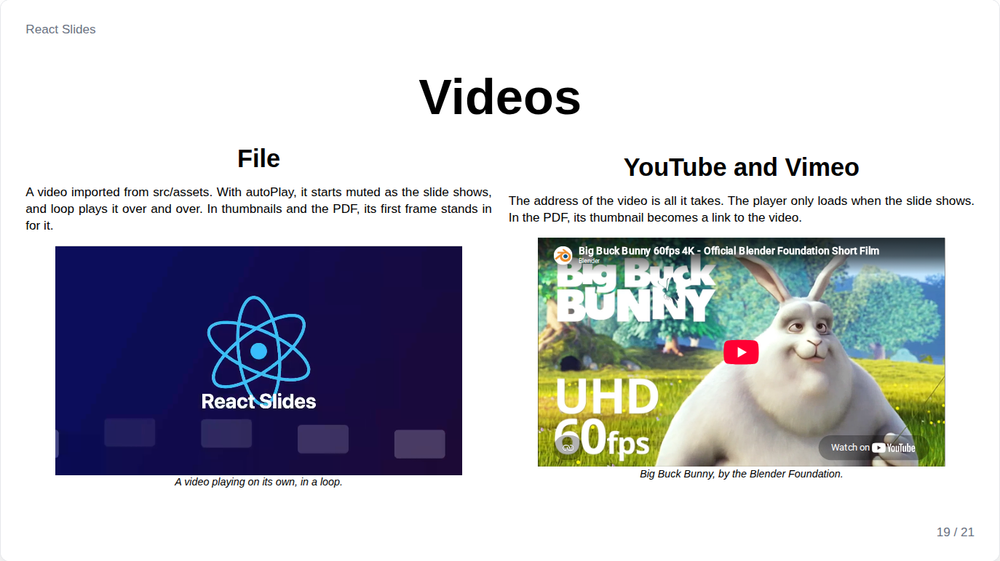

# Images and videos

## Image



```jsx
import photo from '../../assets/photo.jpg';

<Image src={photo} alt="A photo" />
<Image src={photo} alt="A photo" width="1/2">A caption</Image>
<Image src={photo} alt="A photo"><Heading fontSize="3xl">A formatted caption</Heading></Image>
```

An image takes all the room left in its layout by default: the width of its column and the height that remains once the rest of the slide is placed, always keeping its proportions and never overflowing. When several images share a slide, they share the same maximum height.

| Prop | Meaning |
| --- | --- |
| `src`, `alt` | The imported image and its description |
| `width` | `"fill"` by default, a fraction of the room such as `"1/2"`, or `"auto"` for its own size |
| `maxHeight` | A cap as a fraction of the slide height, such as `"1/3"` |
| `align` | `left`, `center` (default) or `right` |
| children | A caption, in italics by default, taking the text props |

An image is enlarged to fill its space, so a small bitmap gets blurry: prefer SVG, or a source around 1920 pixels wide for a full-slide picture.

## Video



`Video` plays a video file imported from `src/assets`, or a YouTube or Vimeo video given by its address:

```jsx
import clip from '../../assets/clip.mp4';

<Video src={clip} autoPlay loop maxHeight="1/2">A looping clip</Video>
<Video src="https://www.youtube.com/watch?v=aqz-KE-bpKQ" alt="Big Buck Bunny" />
```

It is sized like an image, with `width`, `maxHeight`, `align` and a caption as children.

| Prop | Default | Meaning |
| --- | --- | --- |
| `autoPlay` | `false` | Start, muted, as the slide shows |
| `loop` | `false` | Play over and over |
| `muted` | `autoPlay` | Without sound |
| `controls` | `true` | Show the player controls |
| `poster` | | Picture shown before playing, and in thumbnails and the PDF |

A video only plays on the slide presented. Thumbnails and the PDF show its first frame or its poster, the picture of a YouTube video, with a play sign; in the PDF, the picture links to the video.
