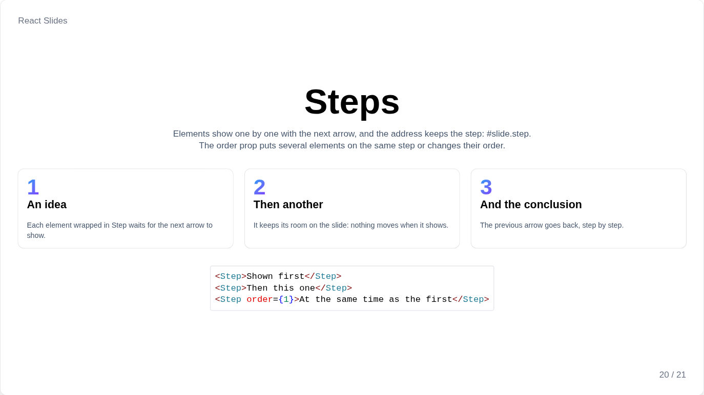

# Steps and transitions

## Steps



Wrap what should appear one step at a time in `Step`: the next arrow reveals the steps in the order of the page before moving to the next slide, and the previous arrow hides them again. A step keeps its room on the slide while hidden, so nothing moves when it appears.

```jsx
<Step>Shown first</Step>
<Step>Then this one</Step>
<Step order={1}>At the same time as the first</Step>
<Paragraph>Visible from the start, <Step as="span">then this word</Step>.</Paragraph>
```

`order` puts several elements on the same step or changes their order; `as` sets the element drawn, a `div` by default, `"span"` inside a sentence.

Thumbnails and the PDF show slides with all their steps; `printSteps` on `<Presentation>` prints one page per step instead.

## Transitions

Moving to the next or previous slide plays its transition: `transition` on `<Presentation>` for the whole deck, or on `<Slide>` for the transition leading to that slide.

| Value | Effect |
| --- | --- |
| `"fade"` | The slides cross-fade, the default |
| `"slide"` | The new slide pushes the old one aside, from the right moving forward, from the left moving back |
| `"none"` | No transition |

```jsx
<Presentation transition="slide">
    <Slide transition="fade"><Chapter /></Slide>
</Presentation>
```

Transitions only move the slide, and nothing plays when the system asks for less motion. Jumping to a slide from its number, the slide list or the mosaic is instant.
