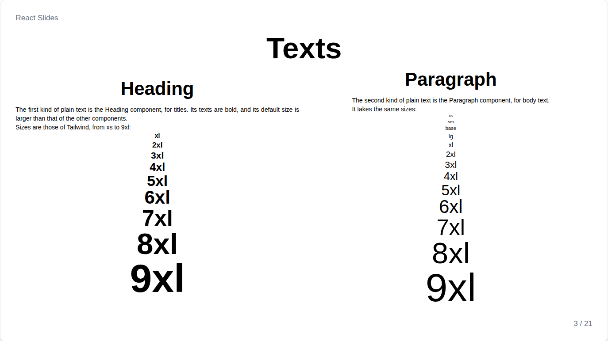
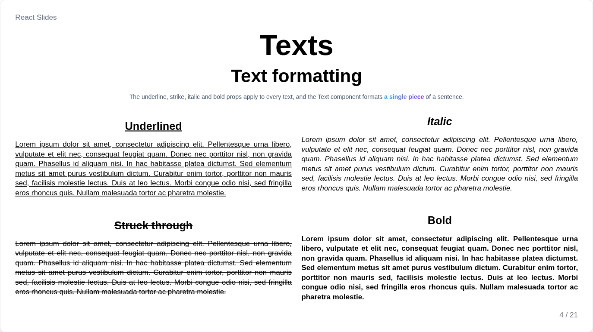
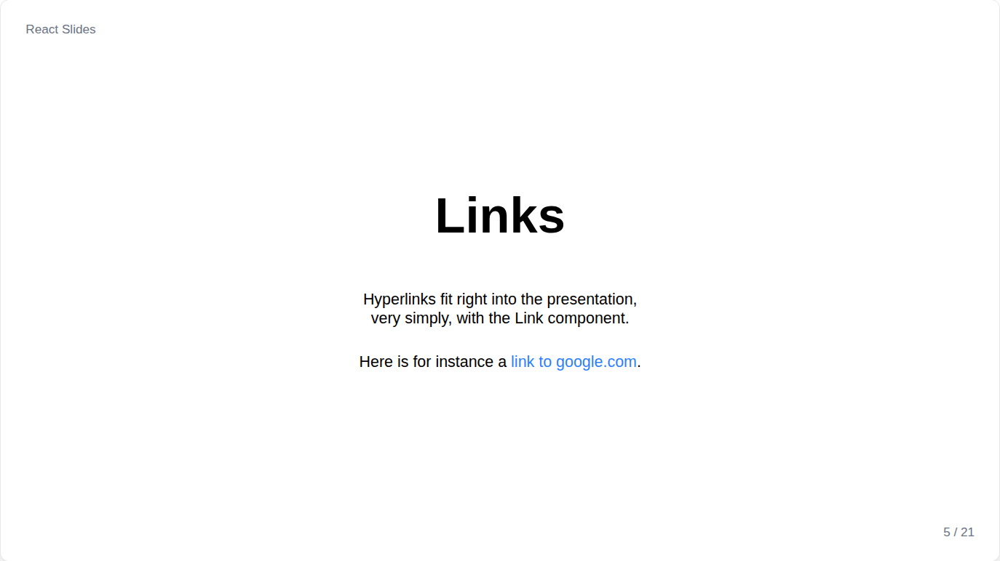
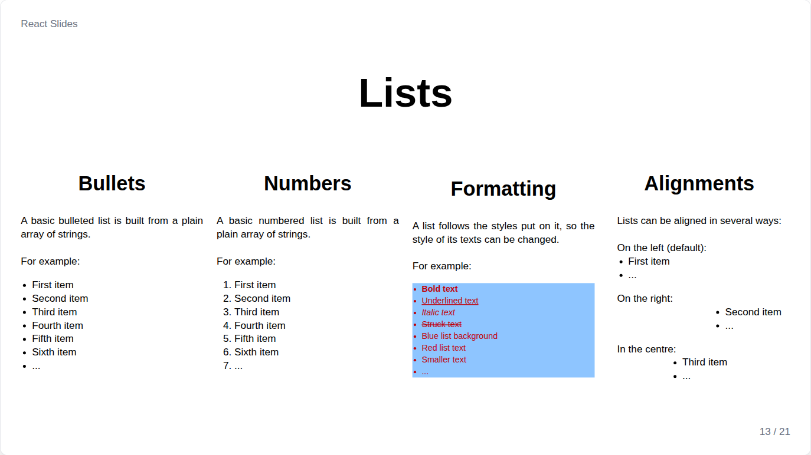
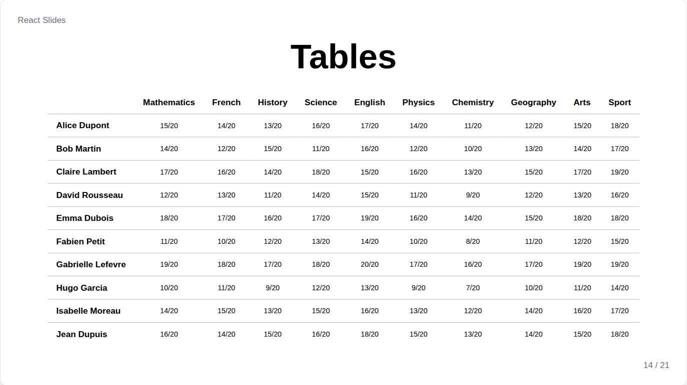

# Texts



Every text component is built on `Text`, so `Heading`, `Paragraph`, `Link`, `List`, `Table` and image captions all take the same props:

| Prop | Meaning |
| --- | --- |
| `fontSize` | A Tailwind size from `"xs"` to `"9xl"`, or any CSS size such as `"3rem"` |
| `align` | `left`, `center`, `right` or `justify` |
| `color`, `bg` | Text and background colors or gradients, see [colors](themes.md#colors) |
| `font` | A font, see [fonts](themes.md#fonts) |
| `bold`, `italic`, `underline`, `strike` | Formatting |

`Heading` defaults to `"6xl"` and bold, the other texts to `"2xl"`.

## Heading and Paragraph

```jsx
<Heading fontSize="8xl" align="center">Title</Heading>
<Heading level={2} fontSize="5xl">Part</Heading>
<Paragraph align="justify">Body text.</Paragraph>
```

`level`, from 1 to 6 and 1 by default, ranks the heading for screen readers; it changes nothing on screen. Headings use `headingFont` when the deck or the slide sets one.

## Formatting



The formatting props apply to a whole text; `Text` formats a piece of a sentence:

```jsx
<Paragraph underline>A whole underlined paragraph</Paragraph>
<Paragraph>Only <Text bold color={["sky-500", "violet-600"]}>these words</Text> stand out.</Paragraph>
```

## Link



```jsx
<Link href="https://react.dev">React documentation</Link>
```

A link to another site opens in a new tab, so the presentation stays open. It is blue by default.

## List



`List` is built from an array; its items may be texts or elements:

```jsx
<List list={["First", "Second", <b key="third">Third</b>]} />
<List type="numbered" align="center" fontSize="3xl" list={parts} />
```

`type` is `"bulleted"`, the default, or `"numbered"`. Markers stay aligned whatever the alignment.

## Table



`Table` is built from an array of rows, each an array of cells, texts or elements:

```jsx
<Table divider="gray-400" content={[
    ["", "Monday", "Tuesday"],
    ["Morning", "Talk", "Workshop"],
    ["Afternoon", "Workshop", "Demo"]
]} />
```

`divider` colors the lines between rows, and `align` the cells, `center` by default.
