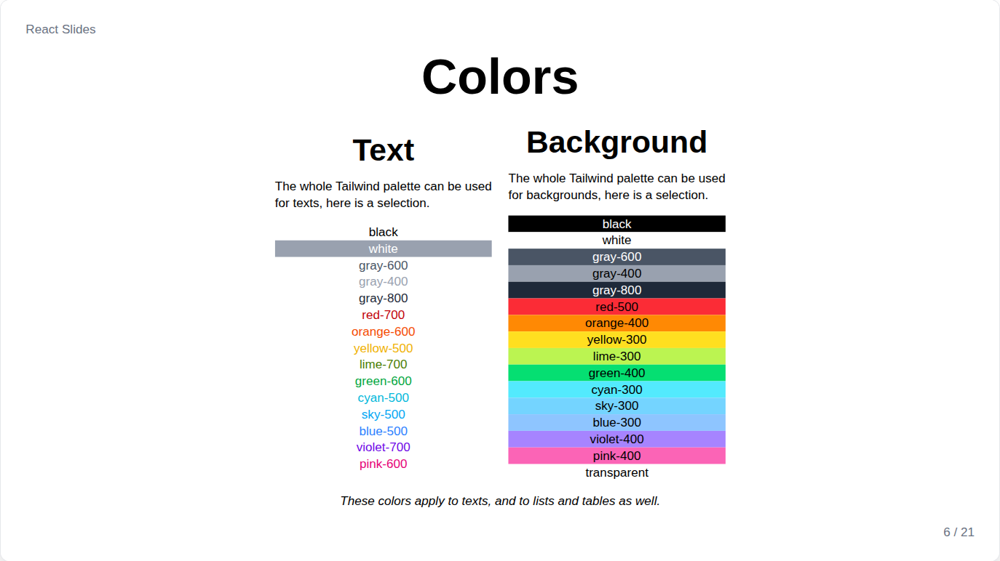
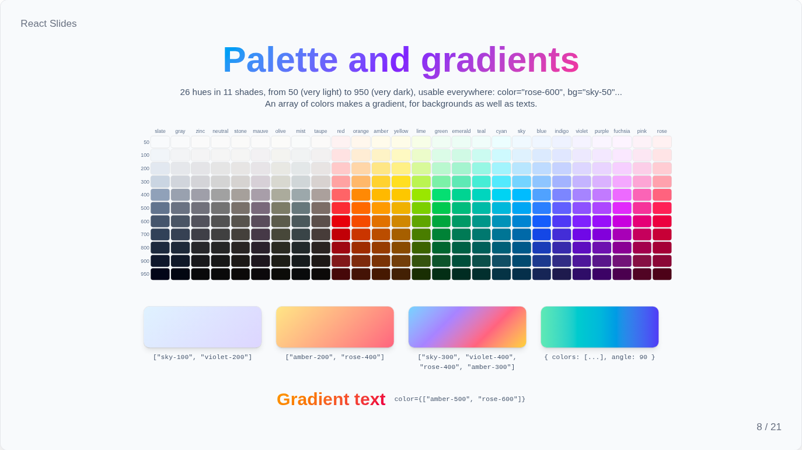
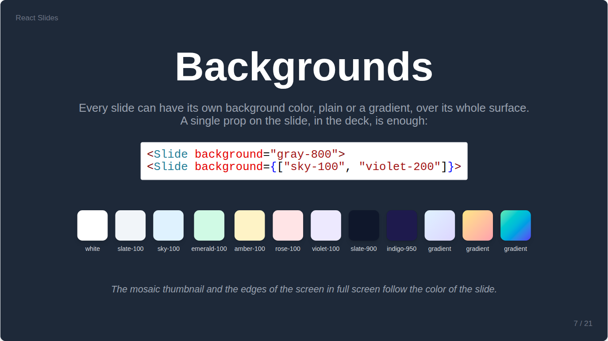
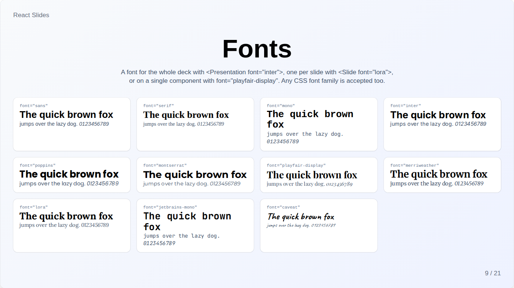
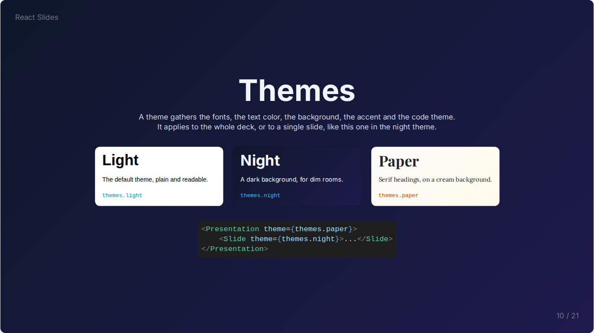

# Colors, fonts and themes

## Colors



Colors, for texts, backgrounds and table dividers, come from the whole Tailwind palette: 26 hues in 11 shades, from `50`, very light, to `950`, very dark, written `"sky-100"` or `"rose-600"`. Any CSS color, such as `"white"` or `"#ff8800"`, works too.



An array of colors makes a diagonal gradient, and an object sets its angle, for backgrounds as well as texts:

```jsx
<Heading color={["sky-500", "violet-600"]}>Gradient title</Heading>
<Paragraph bg={{ colors: ["amber-100", "rose-200"], angle: 90 }}>...</Paragraph>
```

## Backgrounds



`background` colors a whole slide, plainly or with a gradient; the thumbnails and the edges of the screen in full screen follow it.

```jsx
<Slide background="gray-800">
<Slide background={["sky-100", "violet-200"]}>
```

## Fonts



`font` sets the font of the deck on `<Presentation>`, of a slide on `<Slide>`, or of one component. The fonts are `sans`, `serif` and `mono`, from the system, and `inter`, `poppins`, `montserrat`, `playfair-display`, `merriweather`, `lora`, `jetbrains-mono` and `caveat`, bundled with the site so they work offline and load only when used. Any other CSS font family is accepted.

To bundle another font, install its Fontsource package, then import and name it in `src/index.css`:

```css
@import '@fontsource-variable/roboto/wght.css';

@theme static {
    --font-roboto: "Roboto Variable", ui-sans-serif, sans-serif;
}
```

## Themes



A theme gathers the look of a deck in one object: `font`, `headingFont`, `color`, `background`, `accentColor`, `codeTheme`, `diagramTheme`, and even `corners` or `transition`. Three come ready in `src/components/themes.js`: `light`, the default, `night`, dark slate with light text, and `paper`, cream with serif headings.

A theme applies to the whole deck or to one slide, and the props of `<Presentation>`, then of `<Slide>`, still come on top of it. Writing a theme is writing such an object:

```jsx
import themes from '../../components/themes.js';

const brand = { ...themes.light, font: "montserrat", color: "slate-800", accentColor: "#e11d48" };

<Presentation theme={brand}>
    <Slide theme={themes.night}><Chapter /></Slide>
</Presentation>
```

`accentColor` colors the progress bar and the outline of the current thumbnail, and takes any CSS color.
