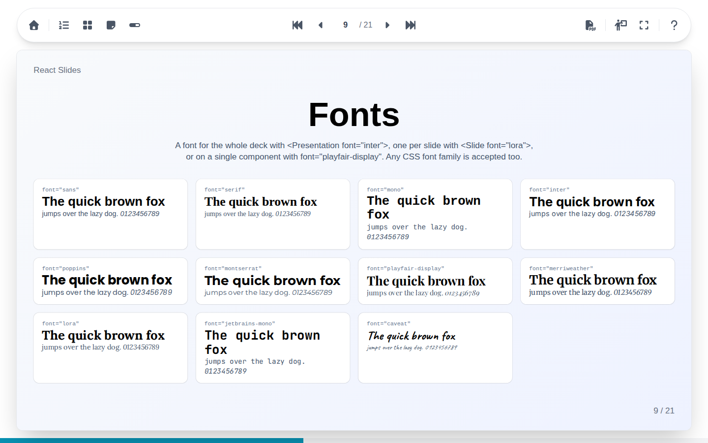

# React Slides

React Slides is a presentation framework for React. Each slide is written with a small set of layout and content components, and the presentations run in any web browser: navigation from the keyboard or a remote, slide overviews, speaker notes, a presenter view for two screens, and an export of the whole deck to PDF.

The site is fully static: it is hosted as it is on GitHub Pages, on any web server, or with the Docker image of the project.

## This guide

- **[Using the interface](interface/index.md)**

    Everything a viewer or a speaker does with a presentation: moving through the slides, the overviews, the notes, full screen, the presenter view on two screens and the PDF export.

- **[Building presentations](building/index.md)**

    How to create a deck and write its slides, with every component: texts, colors and themes, layouts, images and videos, code, Markdown, diagrams, formulas, steps and transitions.

## Trying it

The demo deck presents every component on its own slide, [in English](https://robinhil.github.io/react-slides/demo-en/) and [in French](https://robinhil.github.io/react-slides/demo/). Its source, in `src/decks/demo`, is the best companion of the second part of this guide.

The interface speaks the language of the browser, English or French, and follows the light or dark theme of the system.
