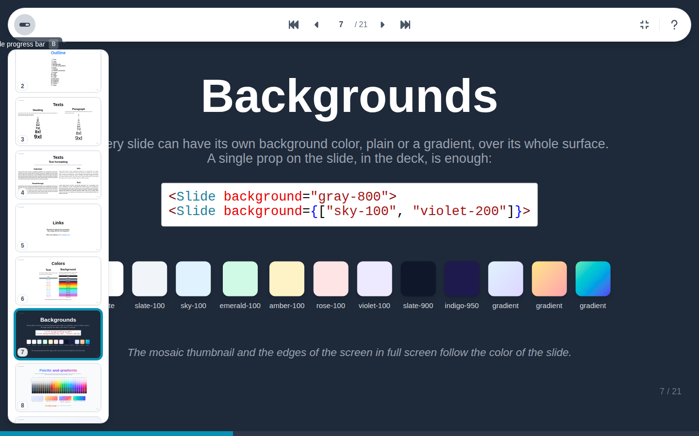

# Full screen

Full screen, from its toolbar button or ++f++, gives the whole screen to the slide; the edges around it take the color of the slide. ++esc++ or ++f++ leaves it.

In full screen, the toolbar keeps only what presenting needs: the progress bar switch, the navigation, full screen and the help. It hides until needed:

- with a mouse, bring it to the top or to the left edge of the screen: the toolbar and the slide list show together, the list below the toolbar. They close as soon as the mouse moves away, or leaves the window for another screen;
- on a touch screen, tap the slide to show or hide the toolbar.

## Progress bar

The bar at the bottom of the screen shows how far the presentation has gone, step by step. Its toolbar button, or ++b++, shows or hides it.
