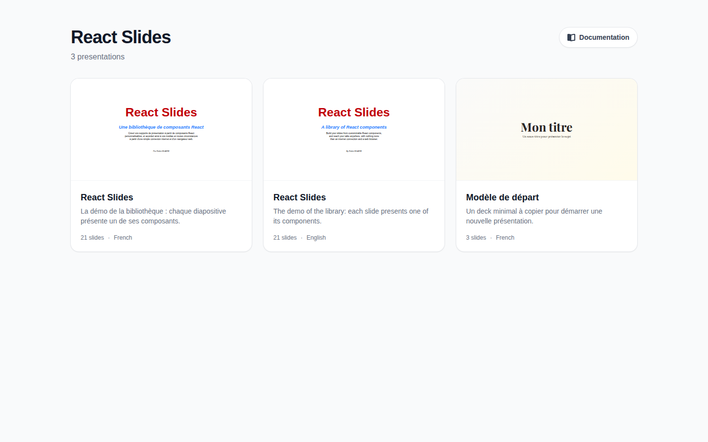

# Home page

The root of the site lists its presentations, one card each.

Each card shows the first slide of the presentation, its title and description, how many slides it holds and the language it is written in. Click a card to open the presentation; the cards further down the page only load when they come near the screen.

The **Documentation** button, at the top right, opens this guide in the language of the interface.

When the site holds a single presentation, its root opens that presentation directly, and the home button of the toolbar is left out.

## Coming back

From a presentation, the house button at the left end of the toolbar, or ++h++, leads back to the home page.

## Addresses

Each presentation has an address of its own, the name of its folder: `/demo/`, `/starter/`. The address also follows the current slide and step, `#7` or `#7.2`: reloading the page keeps the place, and a link opens the presentation right there.
