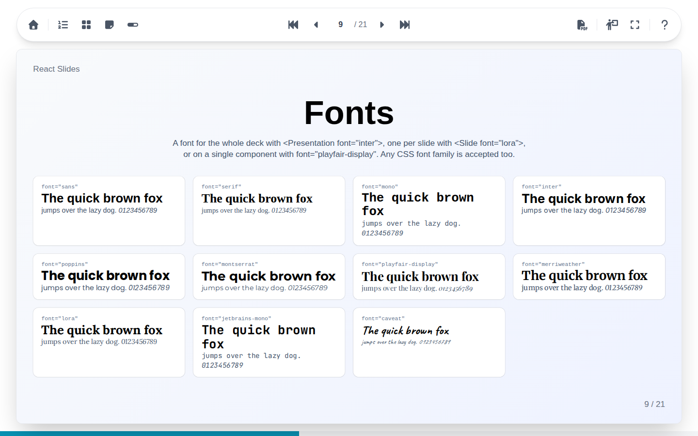
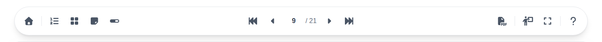
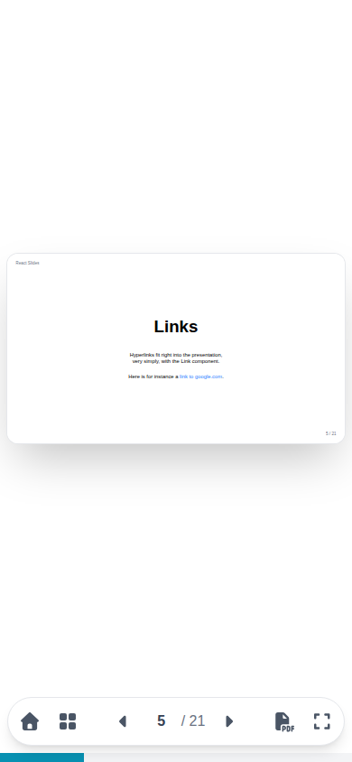

# Using the interface

A presentation fills the window: the toolbar on top, the current slide in the middle, and the progress bar at the bottom.

The toolbar reads from left to right:

| Group | Buttons |
| --- | --- |
| Way out | Back to the [home page](home-page.md) listing the presentations |
| What is shown | [Slide list](overviews.md#slide-list), [mosaic](overviews.md#mosaic), [notes](notes.md), [progress bar](full-screen.md#progress-bar) |
| [Navigation](navigation.md) | First slide, previous, slide number, next, last slide |
| What is done | [Export to PDF](pdf.md), [presenter view](presenter.md), [full screen](full-screen.md) |
| Help | The [keyboard shortcuts](shortcuts.md) |

Resting the mouse on a button shows its name and its keyboard shortcut. The navigation always stays in the middle of the bar; when the bar is narrow, on a phone or beside an open panel, it leaves out its least needed buttons.

## Language and theme

The whole interface speaks the language of the browser, English or French, English for any other language; the slides keep the language they were written in. It follows the light or dark theme of the system, as soon as it changes, and never changes the slides themselves.

## On a phone or a tablet

{ width="300" }

On a phone, the toolbar moves to the bottom of the screen and keeps the essentials: home, mosaic, navigation, PDF export and full screen. Swipe left or right on the slide to change slides.
