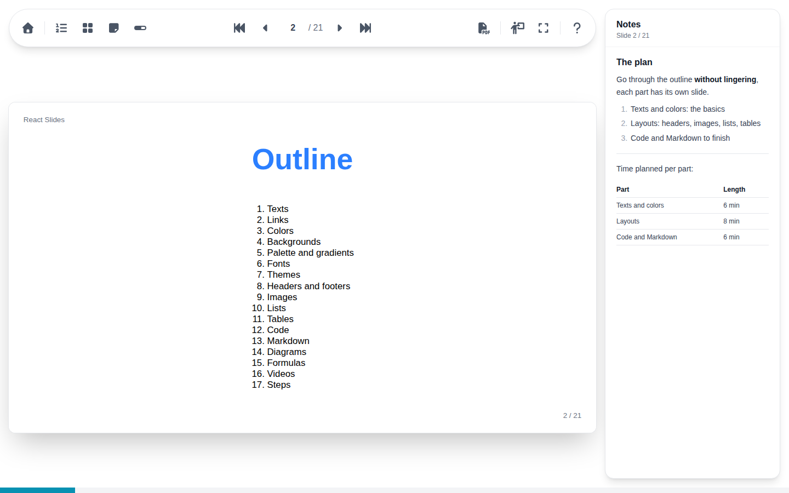

# Speaker notes

The notes panel, from its toolbar button or ++n++, shows the notes of the current slide on the right, and follows the slide as it changes. It stays hidden in full screen: on two screens, the [presenter view](presenter.md) shows the notes on the speaker's screen instead.

Notes are written in Markdown with the slide: bold and italic text, lists and task lists, quotes, code, links, tables, formulas and diagrams. A slide without notes says so.
