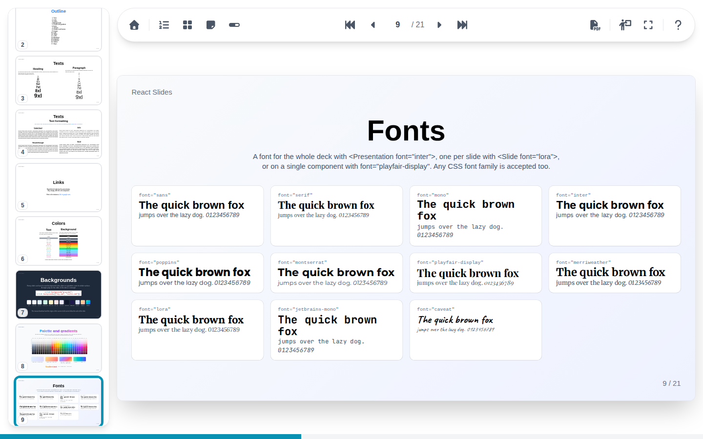
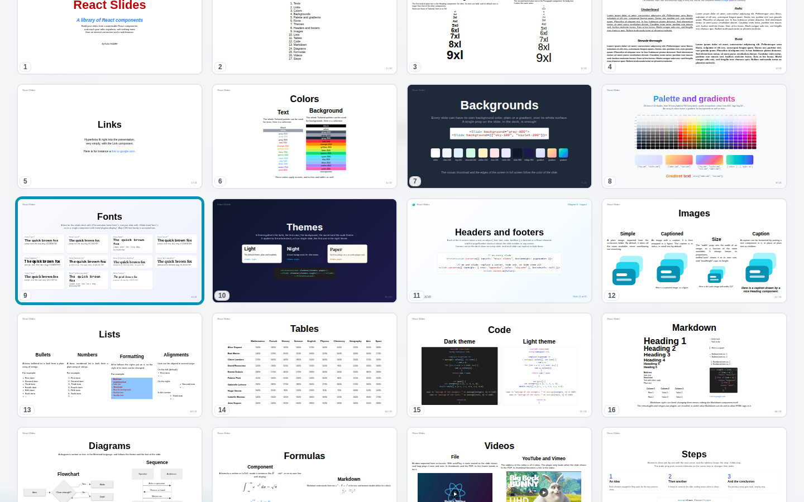

# Slide list and mosaic

Two overviews show every slide at once. Their thumbnails are drawn only near the visible part of the panel, so even a presentation of hundreds of slides scrolls smoothly.

## Slide list

The slide list opens on the left, from its toolbar button or ++s++. It highlights the current slide; click a thumbnail to go there. On a wide screen it stays open beside the slide, elsewhere it closes once a slide is chosen.

## Mosaic

The mosaic covers the whole screen with a grid of every slide, from its toolbar button or ++m++.

| Keys | Action |
| --- | --- |
| Arrows | Move the highlight, the current slide following it |
| ++enter++ | Close the mosaic on the highlighted slide |
| ++esc++ | Close the mosaic |

Click a thumbnail to open it, or anywhere else to close the mosaic.

Thumbnails show each slide with all its steps. A video shows its first frame there, with a play sign.
