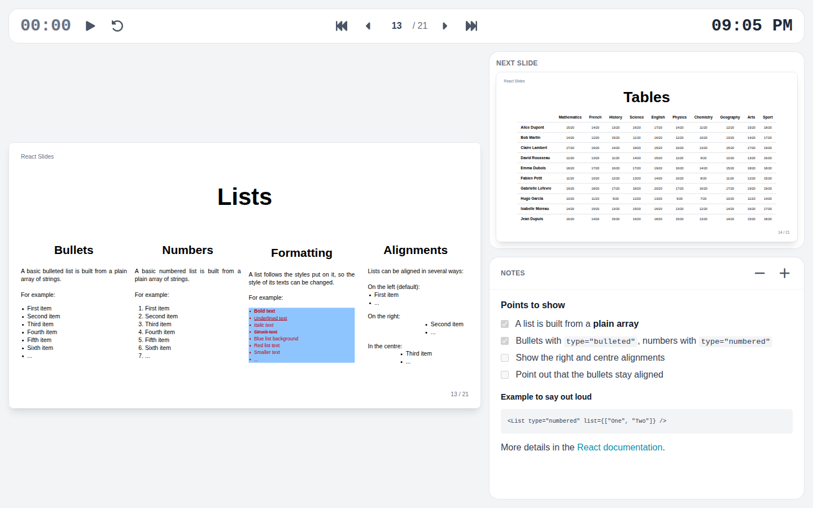

# Presenter view

The presenter view puts on the speaker's screen what the audience does not see: the current slide, the next step or slide, the notes, a timer and the time of day.

## Starting it

The presenter button of the toolbar, or ++v++, opens the presenter view in a window of its own.

- **In Chrome or Edge with two screens**, the presentation goes full screen on the other screen, for the audience, and the presenter view opens on the screen in use. The browser asks once for the right to place windows.
- **Elsewhere**, or with a single screen, the presenter view opens in a new window: move the presentation window to the projector and press ++f++.

## Using it

- The navigation of the presenter view is the same as the toolbar's, keys included; a click on the current slide goes on too. Both windows always show the same slide and step, whichever one moves.
- The timer waits at zero until its play button starts it, then pauses, resumes or resets.
- The minus and plus buttons change the size of the notes; the choice is remembered.

Only these two windows follow each other: another tab of the same presentation stays where it is.

## Ending it

Leaving full screen on the presentation closes the presenter view, and closing the presenter view takes the presentation out of full screen.

The presenter button only shows with a mouse, when the toolbar is wide enough, outside full screen.
