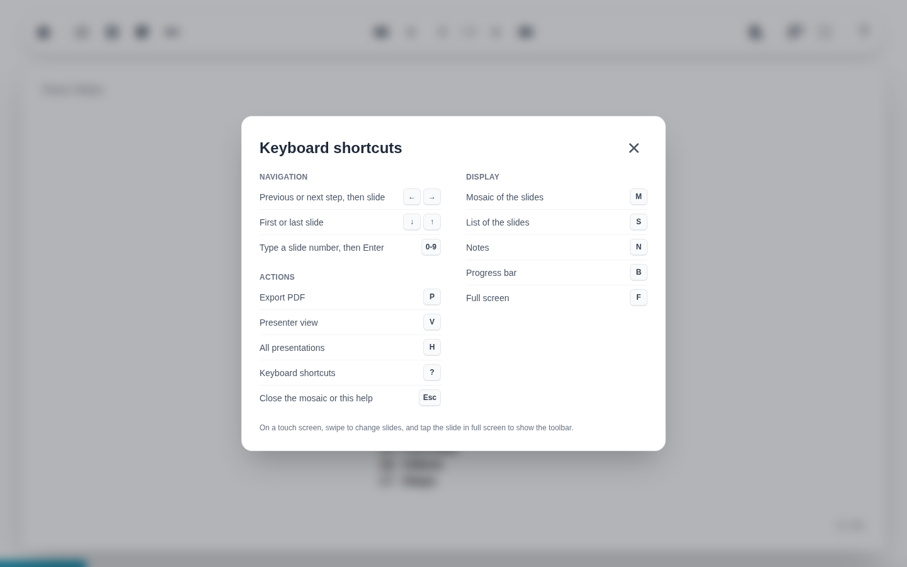

# Keyboard shortcuts

The question mark button at the right end of the toolbar, or <kbd>?</kbd>, lists the keyboard shortcuts.

| Keys | Action |
| --- | --- |
| ++arrow-left++ ++arrow-right++ | Previous and next step, then slide (also ++page-up++ and ++page-down++) |
| ++arrow-down++ ++arrow-up++ | First and last slide |
| ++0++ to ++9++ | Type a slide number, then ++enter++ |
| ++m++ | Mosaic |
| ++s++ | Slide list |
| ++n++ | Notes |
| ++b++ | Progress bar |
| ++f++ | Full screen |
| ++p++ | Export to PDF |
| ++v++ | Presenter view |
| ++h++ | Back to the home page |
| <kbd>?</kbd> | This help |
| ++esc++ | Close the mosaic or the help |

Every shortcut belongs to a button, and works only while its button is shown: no button, no shortcut. In full screen, for instance, ++p++ and ++m++ do nothing, as their buttons are left out. The help only lists the shortcuts available when it opens.

The question mark button is left out of screens without a mouse.
