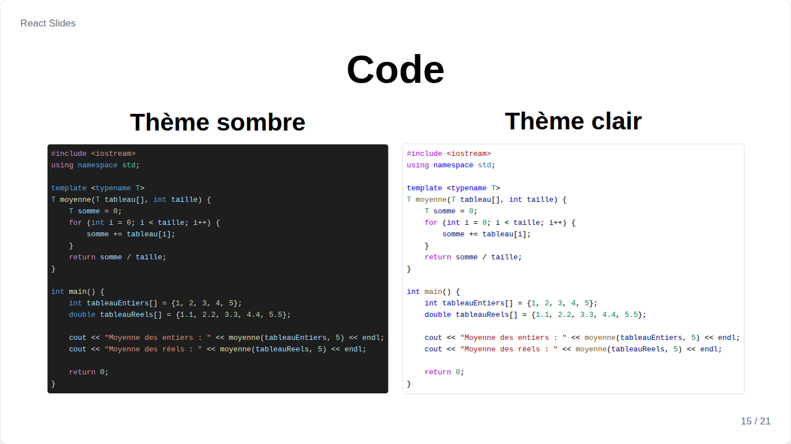
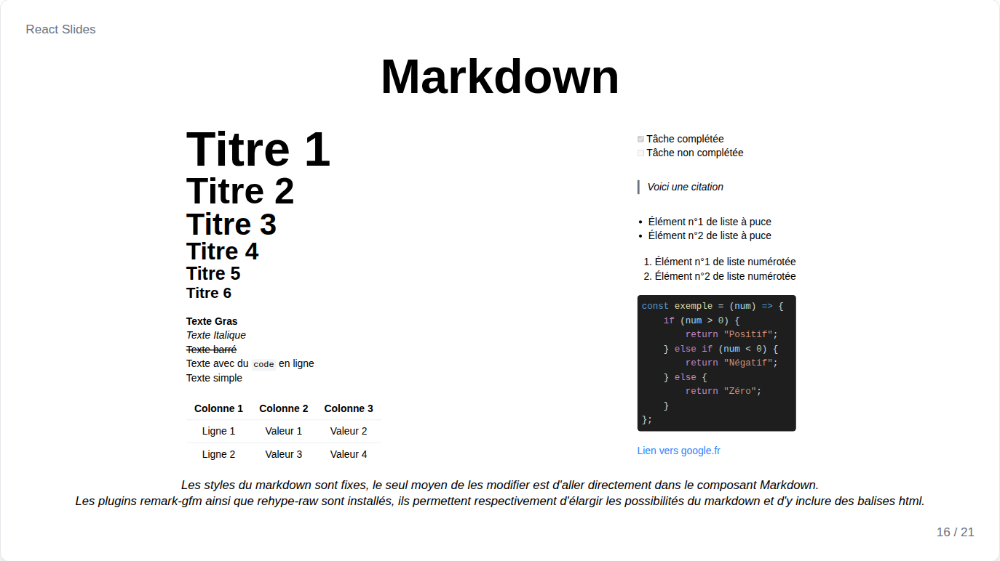

# Code et Markdown

## Code



`Code` colore le code avec Shiki, le moteur de VS Code :

```jsx
<Code language="python">{`print("Bonjour")`}</Code>
<Code language="jsx" theme="light" fontSize="2xl" align="center">{source}</Code>
```

| Prop | Défaut | Rôle |
| --- | --- | --- |
| `language` | aucun | L'un des quelque 230 langages de Shiki, par nom ou alias : `js`, `ts`, `sh`, `c++`... |
| `theme` | le `codeTheme` de la diapositive | `"dark"` ou `"light"` |
| `fontSize` | `"lg"` | Taille du code |
| `align` | `left` | Position du bloc |
| `font` | `mono` | Police du code |

Chaque grammaire est un fichier à part, chargé seulement quand une diapositive affiche ce langage, et la diapositive apparaît une fois son code coloré. Un langage inconnu s'affiche quand même, sans couleurs.

## Markdown



`Markdown` affiche du Markdown avec les composants de la bibliothèque : titres, texte gras, italique et barré, listes et listes de tâches, citations, blocs de code, liens, tableaux, images et HTML brut.

```jsx
<Markdown>{`
## Un titre

Du texte **gras**, et un [lien](https://react.dev).
`}</Markdown>
```

Une image en Markdown s'importe comme les autres :

```jsx
import photo from '../../assets/photo.jpg';

<Markdown>{``}</Markdown>
```

Un bloc ` ```mermaid ` devient un [diagramme](diagrams-and-formulas.md#diagram), et `$...$` et `$$...$$` deviennent des [formules](diagrams-and-formulas.md#formula). `font` fixe la police de tout le texte.
