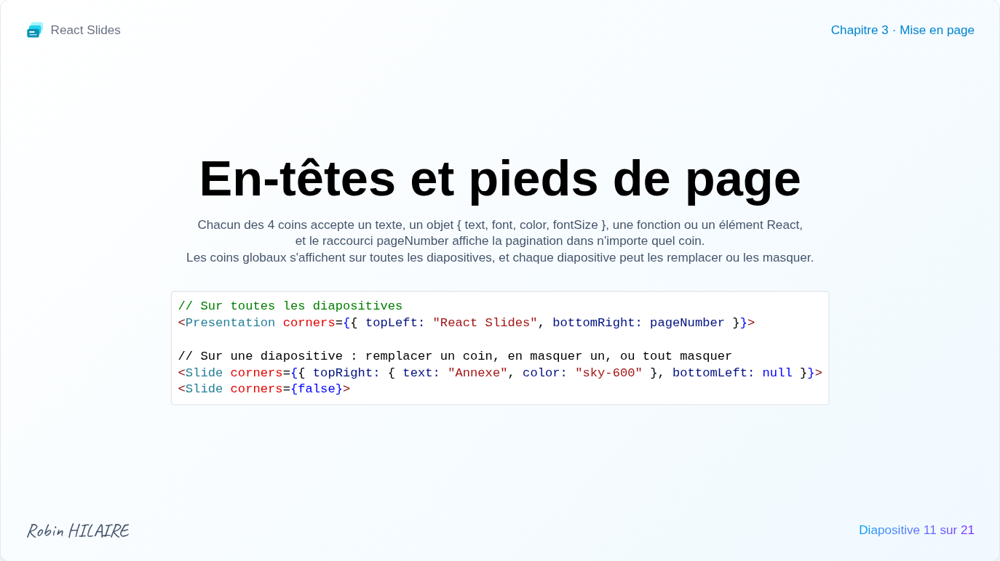

# En-têtes, pieds de page et notes

## Coins



Chacun des quatre coins d'une diapositive, `topLeft`, `topRight`, `bottomLeft` et `bottomRight`, peut accueillir un en-tête ou un pied de page :

- un texte ;
- un objet `{ text, font, color, fontSize }` ;
- une fonction qui reçoit le numéro `number` et le total `total` de la diapositive, et renvoie l'un des deux ;
- n'importe quel élément React, comme un logo.

Les coins non renseignés restent vides, et le contenu de la diapositive leur fait toujours de la place. `pageNumber` affiche « 3 / 16 » dans le coin où il est placé.

```jsx
import pageNumber from '../../components/pageNumber.js';

<Presentation corners={{ topLeft: "React Slides", bottomRight: pageNumber }}>
    <Slide corners={false}><Title /></Slide>
    <Slide corners={{ topRight: { text: "Annexe", color: "sky-600" }, bottomLeft: null }}>
        <Appendix />
    </Slide>
</Presentation>
```

Une diapositive remplace certains coins, en masque un avec `null`, ou les masque tous avec `false`.

## Notes de l'orateur

`notes` sur une diapositive donne ses notes, en Markdown, affichées dans le [panneau des notes](../interface/notes.md) et la [vue présentateur](../interface/presenter.md). La mise en forme, les listes, listes de tâches, citations, code, liens, tableaux, formules et diagrammes sont rendus ; les images et le HTML brut ne le sont pas. L'indentation commune du texte est retirée, pour qu'il puisse suivre celle du code :

```jsx
<Slide notes={`
    ## Message clé

    - Commencer par **la question** à laquelle répond la diapositive
    - Laisser du temps pour les questions

    > Ne pas lire la diapositive à voix haute.
`}>
    <MySlide />
</Slide>
```
