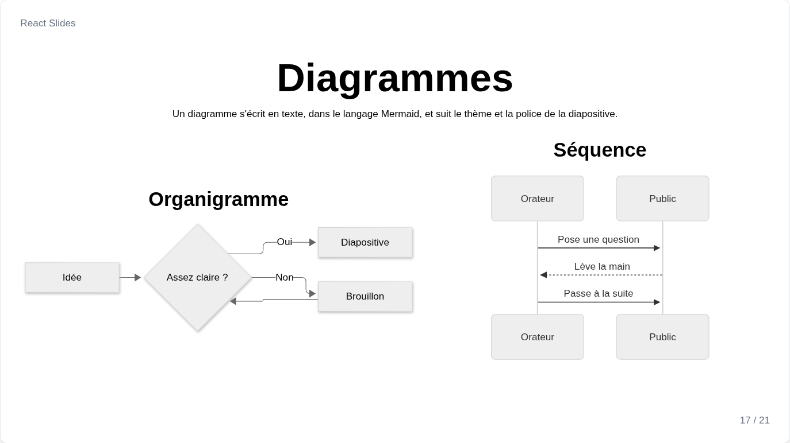
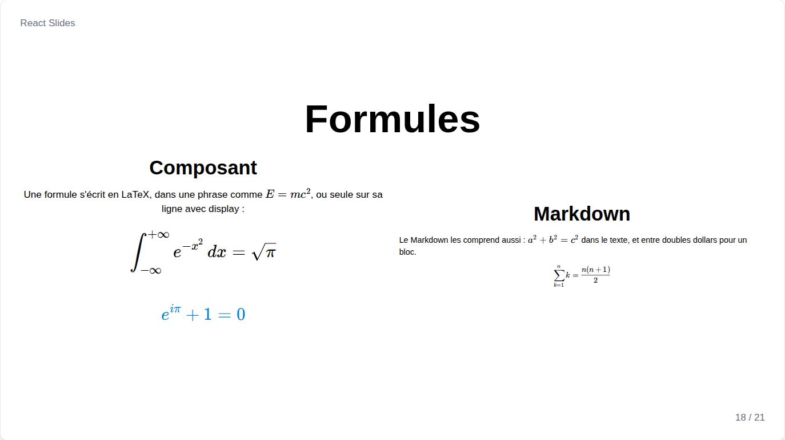

# Diagrammes et formules

Mermaid et KaTeX sont des fichiers à part, chargés seulement par les diapositives qui s'en servent, et tous deux sont dessinés en vectoriel, nets dans le PDF.

## Diagram



`Diagram` dessine un diagramme écrit dans le langage [Mermaid](https://mermaid.js.org) : organigrammes, séquences, classes, états, chronologies, graphiques et toutes les autres sortes que connaît Mermaid. L'indentation du texte est retirée, pour qu'il puisse suivre celle du code :

```jsx
<Diagram>{`
    flowchart LR
        A[Idée] --> B{Assez claire ?}
        B -- Oui --> C[Diapositive]
`}</Diagram>
```

| Prop | Défaut | Rôle |
| --- | --- | --- |
| `fontSize` | `"2xl"` | Taille de son texte ; tout le diagramme suit, et se réduit quand sa colonne est trop étroite |
| `theme` | le `diagramTheme` de la diapositive | `"light"`, `"dark"` ou tout thème Mermaid |
| `align` | `center` | Position du diagramme |
| `font` | la police de la diapositive | Police de son texte |

## Formula



`Formula` écrit une formule en LaTeX avec KaTeX, dans une phrase, ou seule sur sa ligne avec `display`. Une chaîne brute évite de doubler les antislashs :

```jsx
<Paragraph>L'énergie <Formula>{"E = mc^2"}</Formula> vient de la masse.</Paragraph>
<Formula display fontSize="4xl">{String.raw`\int_0^1 x^2\,dx = \frac{1}{3}`}</Formula>
```

`fontSize`, `color` et, avec `display`, `align` fonctionnent comme sur les textes.

## Dans le Markdown et les notes

Dans `Markdown` et dans les notes de l'orateur, un bloc ` ```mermaid ` devient un diagramme, et `$...$` et `$$...$$` deviennent des formules.
