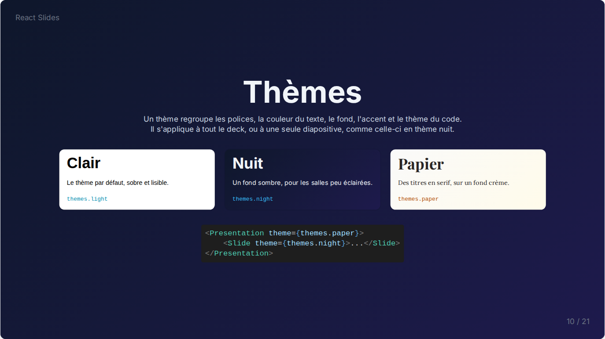

# Mises en page

Les mises en page placent le contenu sur la diapositive ; elles s'imbriquent librement.

| Composant | Props | Rôle |
| --- | --- | --- |
| `CenterLayout` | | Centre son contenu verticalement et horizontalement |
| `TwoColumnLayout` | `leftContent`, `rightContent` | Deux contenus côte à côte |
| `GridLayout` | `columns` (2), `gap` (8), `verticalAlign` | Ses enfants en colonnes égales |
| `RowLayout` | `gap` (8), `align` (`center`), `verticalAlign` (`center`) | Ses enfants côte à côte sur une ligne |
| `Card` | `bg` (`white`) | Une boîte arrondie et ombrée autour de son contenu |
| `ColorSwatch` | `color`, `label`, `size` (`md`), `fontSize`, `labelColor`, `font` | Un échantillon de couleur ou de dégradé |

`gap` suit l'échelle de Tailwind : `gap={6}` vaut `1.5rem`. `align` et `verticalAlign` acceptent `left`, `center`, `right`, `top` ou `bottom`. `ColorSwatch` existe en trois tailles : `fill`, la largeur de sa colonne, `md` et `lg`.

```jsx
<CenterLayout>
    <Heading fontSize="8xl" align="center">Trois idées</Heading>
    <GridLayout columns={3} gap={8}>
        <Card><Paragraph>Une</Paragraph></Card>
        <Card><Paragraph>Deux</Paragraph></Card>
        <Card><Paragraph>Trois</Paragraph></Card>
    </GridLayout>
</CenterLayout>
```

```jsx
<TwoColumnLayout
    leftContent={<Paragraph>Texte à gauche</Paragraph>}
    rightContent={<Image src={photo} alt="Une photo" />}
/>
```


