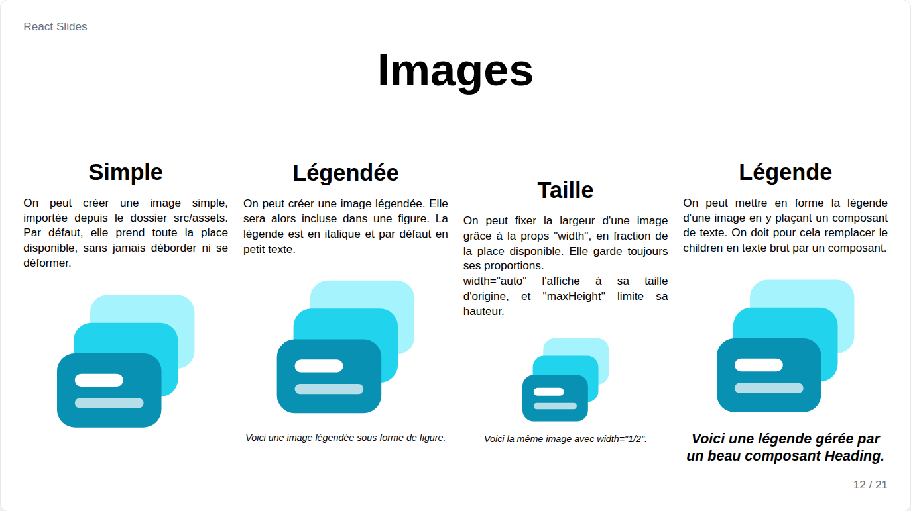
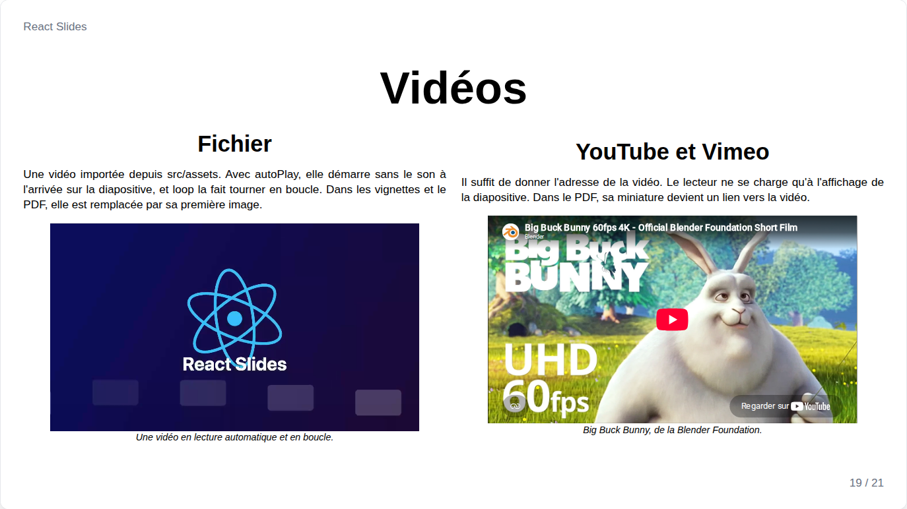

# Images et vidéos

## Image



```jsx
import photo from '../../assets/photo.jpg';

<Image src={photo} alt="Une photo" />
<Image src={photo} alt="Une photo" width="1/2">Une légende</Image>
<Image src={photo} alt="Une photo"><Heading fontSize="3xl">Une légende mise en forme</Heading></Image>
```

Par défaut, une image prend toute la place restante dans sa mise en page : la largeur de sa colonne et la hauteur qui reste une fois le reste de la diapositive placé, en gardant toujours ses proportions et sans jamais déborder. Quand plusieurs images partagent une diapositive, elles partagent la même hauteur maximale.

| Prop | Rôle |
| --- | --- |
| `src`, `alt` | L'image importée et sa description |
| `width` | `"fill"` par défaut, une fraction de la place comme `"1/2"`, ou `"auto"` pour sa taille d'origine |
| `maxHeight` | Une limite en fraction de la hauteur de la diapositive, comme `"1/3"` |
| `align` | `left`, `center` (par défaut) ou `right` |
| enfants | Une légende, en italique par défaut, qui accepte les props des textes |

Une image est agrandie pour remplir sa place, et une petite image matricielle devient floue : préférez le SVG, ou une source d'environ 1920 pixels de large pour une image pleine diapositive.

## Video



`Video` lit un fichier vidéo importé depuis `src/assets`, ou une vidéo YouTube ou Vimeo donnée par son adresse :

```jsx
import clip from '../../assets/clip.mp4';

<Video src={clip} autoPlay loop maxHeight="1/2">Une boucle</Video>
<Video src="https://www.youtube.com/watch?v=aqz-KE-bpKQ" alt="Big Buck Bunny" />
```

Elle se dimensionne comme une image, avec `width`, `maxHeight`, `align` et une légende en enfant.

| Prop | Défaut | Rôle |
| --- | --- | --- |
| `autoPlay` | `false` | Démarrer, sans le son, à l'affichage de la diapositive |
| `loop` | `false` | Lire en boucle |
| `muted` | `autoPlay` | Sans le son |
| `controls` | `true` | Afficher les contrôles du lecteur |
| `poster` | | Image affichée avant la lecture, et dans les miniatures et le PDF |

Une vidéo ne joue que sur la diapositive présentée. Les miniatures et le PDF montrent sa première image ou son affiche, l'image d'une vidéo YouTube, avec un signe lecture ; dans le PDF, l'image mène à la vidéo.
