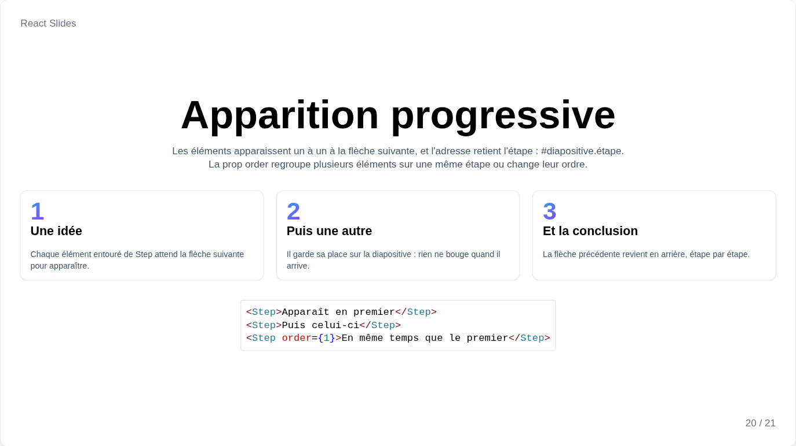

# Étapes et transitions

## Étapes



Entourez de `Step` ce qui doit apparaître étape par étape : la flèche suivante dévoile les étapes dans l'ordre de la page avant de passer à la diapositive suivante, et la flèche précédente les masque à nouveau. Une étape garde sa place sur la diapositive tant qu'elle est masquée : rien ne bouge quand elle apparaît.

```jsx
<Step>Apparaît en premier</Step>
<Step>Puis celui-ci</Step>
<Step order={1}>En même temps que le premier</Step>
<Paragraph>Visible dès le début, <Step as="span">puis ce mot</Step>.</Paragraph>
```

`order` place plusieurs éléments sur la même étape ou change leur ordre ; `as` fixe l'élément dessiné, un `div` par défaut, `"span"` au milieu d'une phrase.

Les miniatures et le PDF montrent les diapositives avec toutes leurs étapes ; `printSteps` sur `<Presentation>` imprime plutôt une page par étape.

## Transitions

Passer à la diapositive suivante ou précédente joue sa transition : `transition` sur `<Presentation>` pour toute la présentation, ou sur `<Slide>` pour la transition qui mène à cette diapositive.

| Valeur | Effet |
| --- | --- |
| `"fade"` | Les diapositives se fondent l'une dans l'autre, par défaut |
| `"slide"` | La nouvelle diapositive pousse l'ancienne, depuis la droite en avançant, depuis la gauche en reculant |
| `"none"` | Pas de transition |

```jsx
<Presentation transition="slide">
    <Slide transition="fade"><Chapter /></Slide>
</Presentation>
```

Les transitions ne déplacent que la diapositive, et rien ne joue quand le système demande moins d'animations. Aller à une diapositive par son numéro, la liste ou la mosaïque est instantané.
