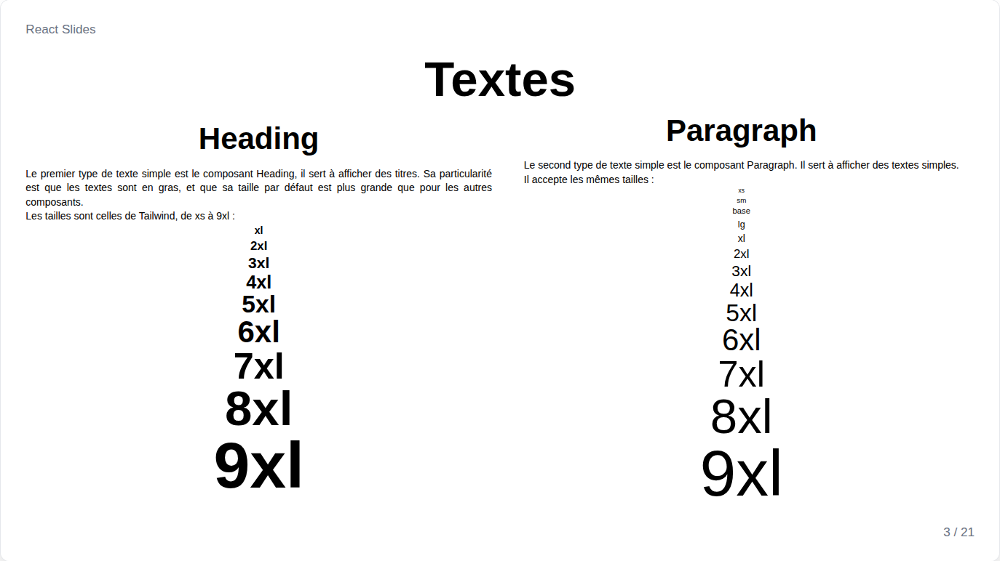
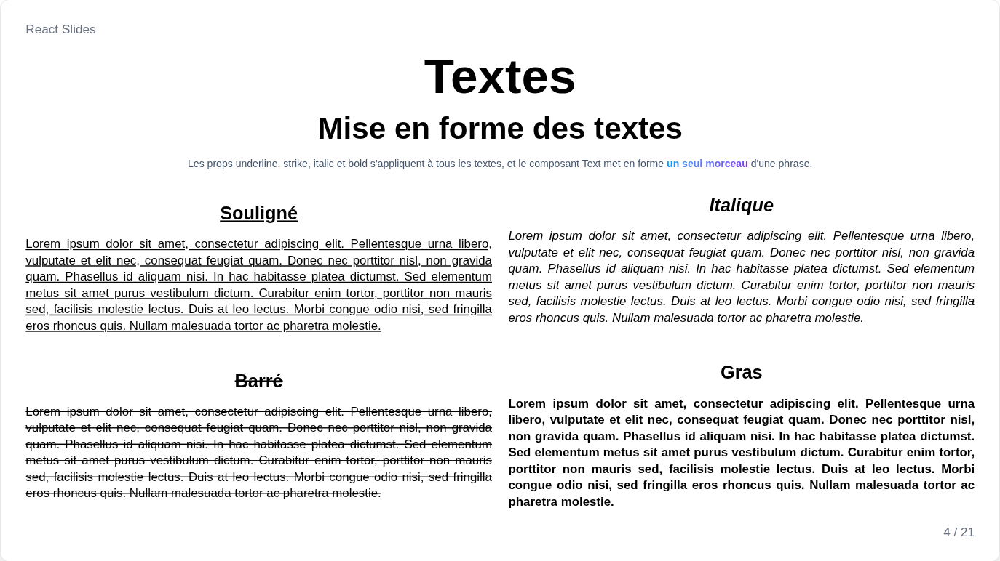
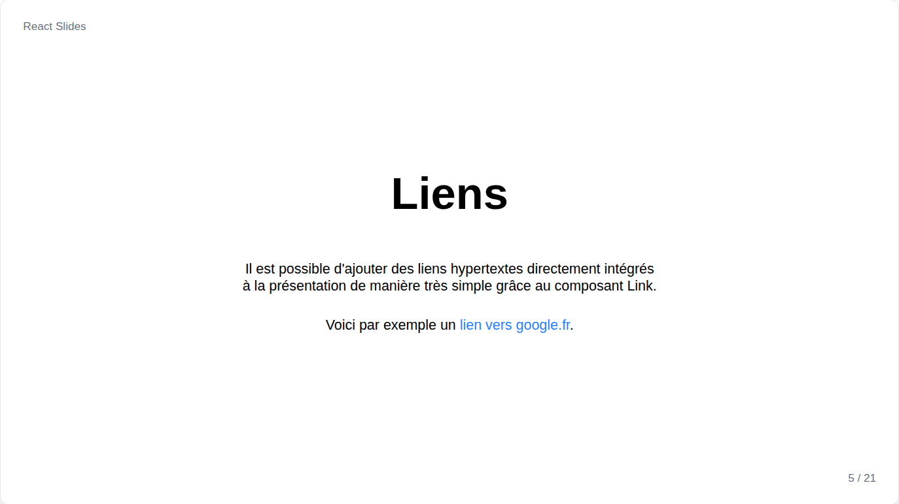
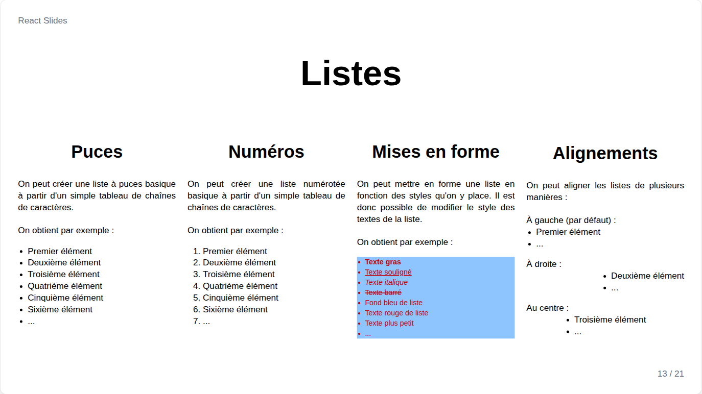
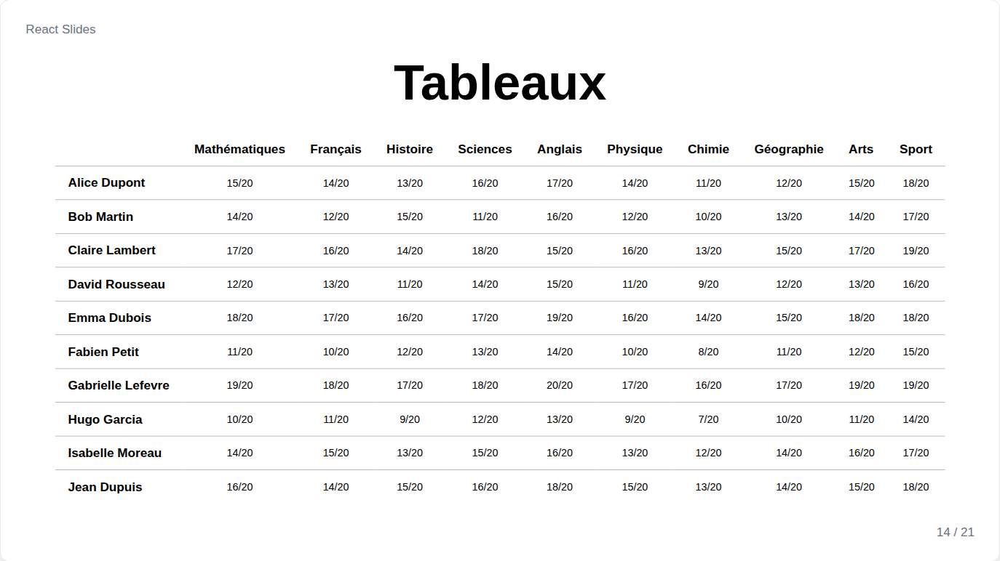

# Textes



Tous les composants de texte reposent sur `Text` : `Heading`, `Paragraph`, `Link`, `List`, `Table` et les légendes d'images acceptent donc les mêmes props :

| Prop | Rôle |
| --- | --- |
| `fontSize` | Une taille Tailwind de `"xs"` à `"9xl"`, ou toute taille CSS comme `"3rem"` |
| `align` | `left`, `center`, `right` ou `justify` |
| `color`, `bg` | Couleurs ou dégradés du texte et du fond, voir [couleurs](themes.md#couleurs) |
| `font` | Une police, voir [polices](themes.md#polices) |
| `bold`, `italic`, `underline`, `strike` | Mise en forme |

`Heading` vaut `"6xl"` et gras par défaut, les autres textes `"2xl"`.

## Heading et Paragraph

```jsx
<Heading fontSize="8xl" align="center">Titre</Heading>
<Heading level={2} fontSize="5xl">Partie</Heading>
<Paragraph align="justify">Texte courant.</Paragraph>
```

`level`, de 1 à 6 et 1 par défaut, donne le rang du titre pour les lecteurs d'écran ; il ne change rien à l'écran. Les titres utilisent `headingFont` quand la présentation ou la diapositive en fixe une.

## Mise en forme



Les props de mise en forme s'appliquent à tout un texte ; `Text` met en forme un morceau de phrase :

```jsx
<Paragraph underline>Tout un paragraphe souligné</Paragraph>
<Paragraph>Seuls <Text bold color={["sky-500", "violet-600"]}>ces mots</Text> ressortent.</Paragraph>
```

## Link



```jsx
<Link href="https://react.dev">Documentation de React</Link>
```

Un lien vers un autre site s'ouvre dans un nouvel onglet, pour que la présentation reste ouverte. Il est bleu par défaut.

## List



`List` se construit à partir d'un tableau ; ses éléments peuvent être des textes ou des éléments :

```jsx
<List list={["Premier", "Deuxième", <b key="third">Troisième</b>]} />
<List type="numbered" align="center" fontSize="3xl" list={parts} />
```

`type` vaut `"bulleted"`, par défaut, ou `"numbered"`. Les puces restent alignées quel que soit l'alignement.

## Table



`Table` se construit à partir d'un tableau de lignes, chacune un tableau de cellules, textes ou éléments :

```jsx
<Table divider="gray-400" content={[
    ["", "Lundi", "Mardi"],
    ["Matin", "Exposé", "Atelier"],
    ["Après-midi", "Atelier", "Démo"]
]} />
```

`divider` colore les lignes entre les rangées, et `align` les cellules, `center` par défaut.
