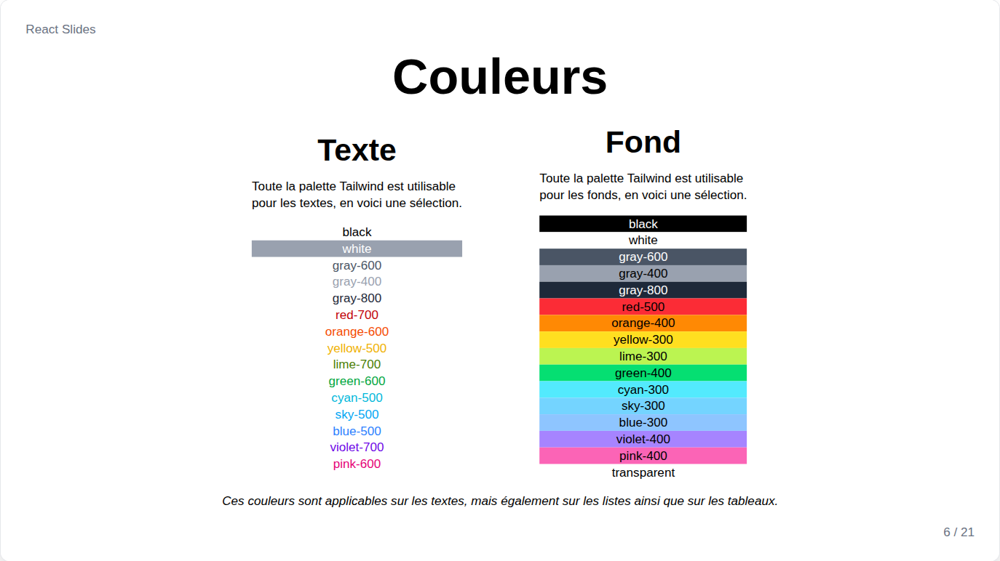
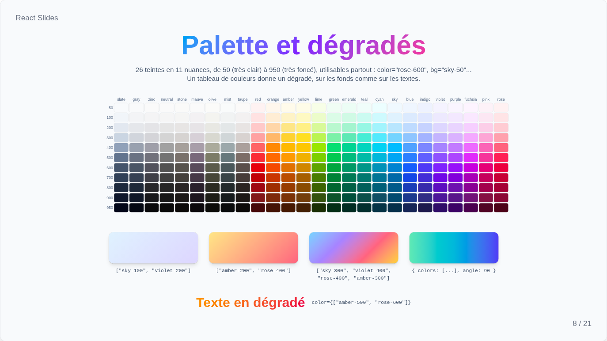
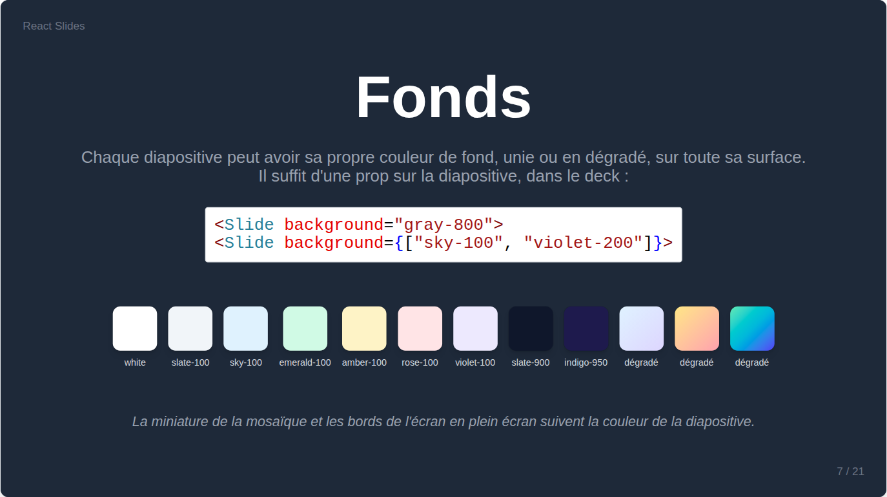
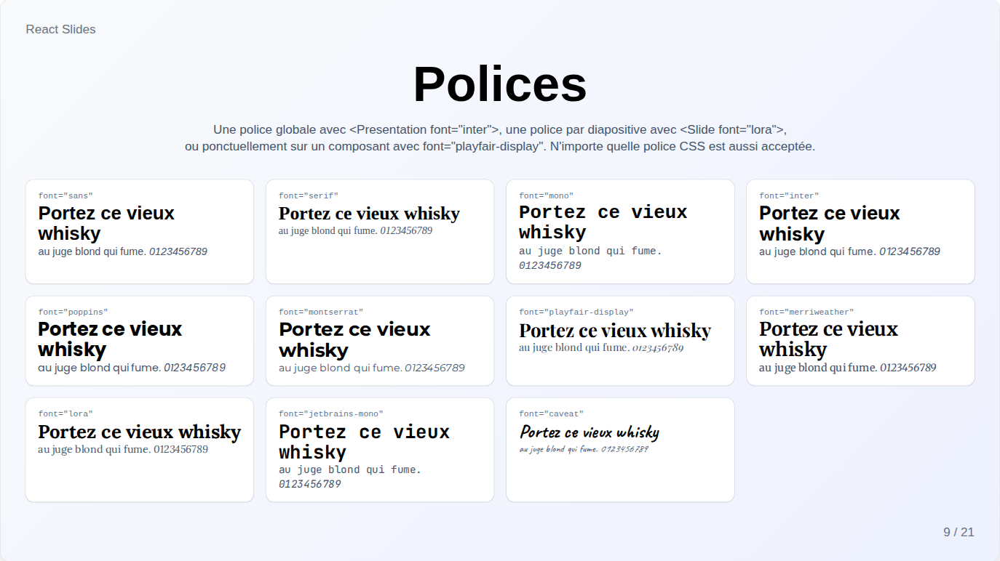
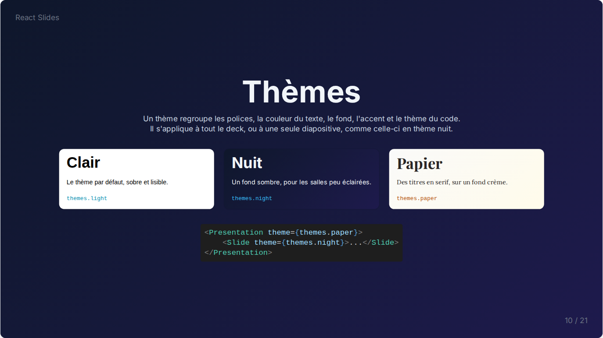

# Couleurs, polices et thèmes

## Couleurs



Les couleurs, des textes, des fonds et des séparateurs de tableaux, viennent de toute la palette Tailwind : 26 teintes en 11 nuances, de `50`, très clair, à `950`, très foncé, écrites `"sky-100"` ou `"rose-600"`. Toute couleur CSS, comme `"white"` ou `"#ff8800"`, convient aussi.



Un tableau de couleurs donne un dégradé en diagonale, et un objet fixe son angle, pour les fonds comme pour les textes :

```jsx
<Heading color={["sky-500", "violet-600"]}>Titre en dégradé</Heading>
<Paragraph bg={{ colors: ["amber-100", "rose-200"], angle: 90 }}>...</Paragraph>
```

## Fonds



`background` colore toute une diapositive, d'une couleur unie ou d'un dégradé ; les miniatures et les bords de l'écran en plein écran la suivent.

```jsx
<Slide background="gray-800">
<Slide background={["sky-100", "violet-200"]}>
```

## Polices



`font` fixe la police de la présentation sur `<Presentation>`, d'une diapositive sur `<Slide>`, ou d'un seul composant. Les polices sont `sans`, `serif` et `mono`, celles du système, et `inter`, `poppins`, `montserrat`, `playfair-display`, `merriweather`, `lora`, `jetbrains-mono` et `caveat`, fournies avec le site pour fonctionner hors ligne et ne se charger qu'à l'usage. Toute autre famille de police CSS est acceptée.

Pour fournir une autre police, installez son paquet Fontsource, puis importez-la et nommez-la dans `src/index.css` :

```css
@import '@fontsource-variable/roboto/wght.css';

@theme static {
    --font-roboto: "Roboto Variable", ui-sans-serif, sans-serif;
}
```

## Thèmes



Un thème réunit l'apparence d'une présentation dans un seul objet : `font`, `headingFont`, `color`, `background`, `accentColor`, `codeTheme`, `diagramTheme`, et même `corners` ou `transition`. Trois sont prêts dans `src/components/themes.js` : `light`, par défaut, `night`, ardoise sombre et texte clair, et `paper`, crème avec des titres en serif.

Un thème s'applique à toute la présentation ou à une diapositive, et les props de `<Presentation>`, puis de `<Slide>`, passent toujours par-dessus. Écrire un thème, c'est écrire un tel objet :

```jsx
import themes from '../../components/themes.js';

const brand = { ...themes.light, font: "montserrat", color: "slate-800", accentColor: "#e11d48" };

<Presentation theme={brand}>
    <Slide theme={themes.night}><Chapter /></Slide>
</Presentation>
```

`accentColor` colore la barre de progression et le contour de la miniature en cours, et accepte toute couleur CSS.
