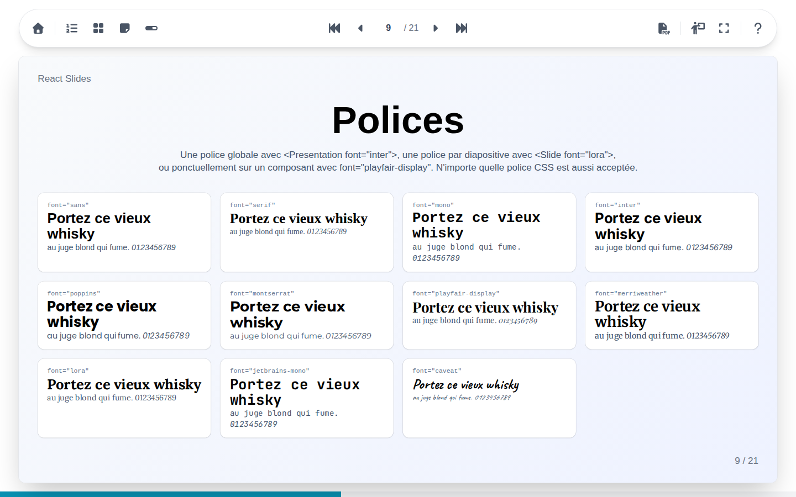

# React Slides

React Slides est un framework de présentations pour React. Chaque diapositive s'écrit avec un petit ensemble de composants de mise en page et de contenu, et les présentations tournent dans n'importe quel navigateur : navigation au clavier ou à la télécommande, vues d'ensemble des diapositives, notes de l'orateur, vue présentateur sur deux écrans, et export de toute la présentation en PDF.

Le site est entièrement statique : il s'héberge tel quel sur GitHub Pages, sur n'importe quel serveur web, ou avec l'image Docker du projet.

## Ce guide

- **[Utiliser l'interface](interface/index.md)**

    Tout ce que fait un spectateur ou un orateur avec une présentation : parcourir les diapositives, les vues d'ensemble, les notes, le plein écran, la vue présentateur sur deux écrans et l'export PDF.

- **[Construire ses présentations](building/index.md)**

    Créer une présentation et écrire ses diapositives, avec chaque composant : textes, couleurs et thèmes, mises en page, images et vidéos, code, Markdown, diagrammes, formules, étapes et transitions.

## Essayer

La présentation de démo consacre une diapositive à chaque composant, [en français](https://robinhil.github.io/react-slides/demo/) et [en anglais](https://robinhil.github.io/react-slides/demo-en/). Sa source, dans `src/decks/demo`, accompagne au mieux la seconde partie de ce guide.

L'interface parle la langue du navigateur, français ou anglais, et suit le thème clair ou sombre du système.
