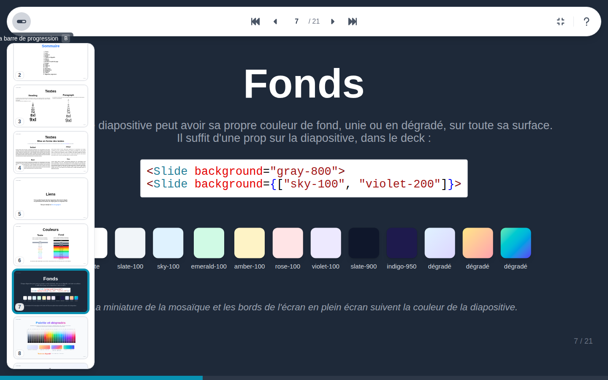

# Plein écran

Le plein écran, par son bouton ou ++f++, donne tout l'écran à la diapositive ; les bords autour prennent la couleur de la diapositive. ++esc++ ou ++f++ en sort.

En plein écran, la barre d'outils ne garde que ce qui sert à présenter : la barre de progression, la navigation, le plein écran et l'aide. Elle se cache jusqu'à ce qu'on en ait besoin :

- à la souris, amenez-la en haut ou sur le bord gauche de l'écran : la barre d'outils et la liste des diapositives s'affichent ensemble, la liste sous la barre. Elles se referment dès que la souris s'éloigne, ou quitte la fenêtre pour un autre écran ;
- sur un écran tactile, touchez la diapositive pour afficher ou masquer la barre d'outils.

## Barre de progression

La barre en bas de l'écran montre l'avancement de la présentation, étape par étape. Son bouton, ou ++b++, l'affiche ou la masque.
