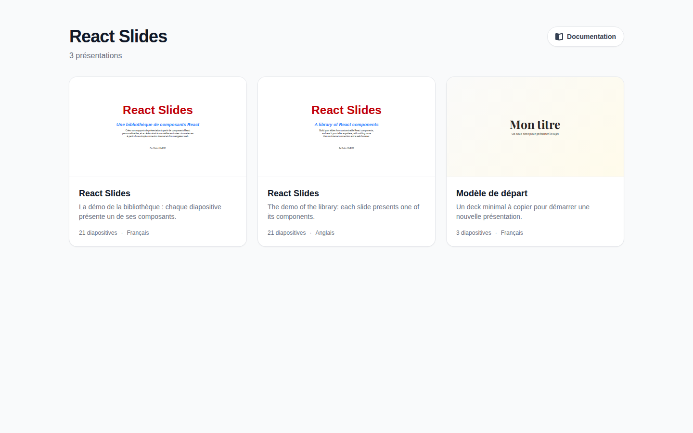

# Page d'accueil

La racine du site liste ses présentations, une carte chacune.

Chaque carte montre la première diapositive de la présentation, son titre et sa description, son nombre de diapositives et la langue dans laquelle elle est écrite. Cliquez sur une carte pour ouvrir la présentation ; les cartes plus bas dans la page ne se chargent qu'à l'approche de l'écran.

Le bouton **Documentation**, en haut à droite, ouvre ce guide dans la langue de l'interface.

Quand le site ne contient qu'une présentation, sa racine ouvre directement cette présentation, et le bouton d'accueil de la barre d'outils disparaît.

## Revenir à l'accueil

Depuis une présentation, le bouton maison tout à gauche de la barre d'outils, ou ++h++, ramène à la page d'accueil.

## Adresses

Chaque présentation a sa propre adresse, le nom de son dossier : `/demo/`, `/starter/`. L'adresse suit aussi la diapositive et l'étape en cours, `#7` ou `#7.2` : recharger la page garde la position, et un lien ouvre la présentation à cet endroit précis.
