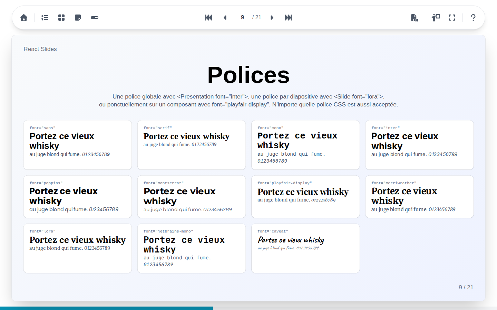
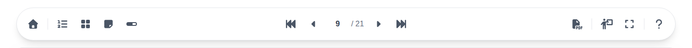
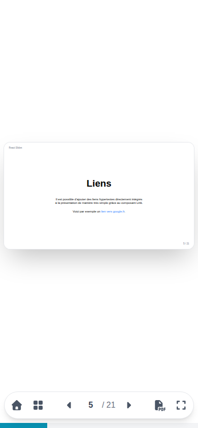

# Utiliser l'interface

Une présentation occupe toute la fenêtre : la barre d'outils en haut, la diapositive au centre, et la barre de progression en bas.

La barre d'outils se lit de gauche à droite :

| Groupe | Boutons |
| --- | --- |
| Sortie | Retour à la [page d'accueil](home-page.md) qui liste les présentations |
| Ce qui s'affiche | [Liste des diapositives](overviews.md#liste-des-diapositives), [mosaïque](overviews.md#mosaique), [notes](notes.md), [barre de progression](full-screen.md#barre-de-progression) |
| [Navigation](navigation.md) | Première diapositive, précédente, numéro, suivante, dernière |
| Ce qu'on fait | [Export PDF](pdf.md), [vue présentateur](presenter.md), [plein écran](full-screen.md) |
| Aide | Les [raccourcis clavier](shortcuts.md) |

Laisser la souris sur un bouton affiche son nom et son raccourci clavier. La navigation reste toujours au centre de la barre ; quand la barre est étroite, sur un téléphone ou à côté d'un panneau ouvert, elle laisse de côté ses boutons les moins utiles.

## Langue et thème

Toute l'interface parle la langue du navigateur, français ou anglais, et l'anglais pour toute autre langue ; les diapositives gardent la langue dans laquelle elles sont écrites. Elle suit le thème clair ou sombre du système, dès qu'il change, sans jamais toucher aux diapositives elles-mêmes.

## Sur un téléphone ou une tablette

{ width="300" }

Sur un téléphone, la barre d'outils passe en bas de l'écran et garde l'essentiel : accueil, mosaïque, navigation, export PDF et plein écran. Glissez vers la gauche ou la droite sur la diapositive pour changer de diapositive.
