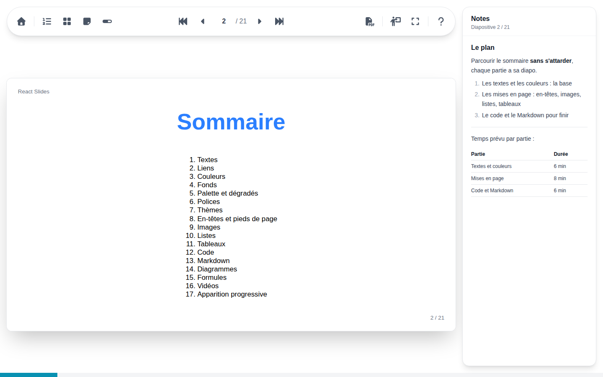

# Notes de l'orateur

Le panneau des notes, par son bouton ou ++n++, affiche à droite les notes de la diapositive en cours, et suit la diapositive quand elle change. Il reste masqué en plein écran : sur deux écrans, la [vue présentateur](presenter.md) affiche les notes sur l'écran de l'orateur.

Les notes s'écrivent en Markdown avec la diapositive : texte gras et italique, listes et listes de tâches, citations, code, liens, tableaux, formules et diagrammes. Une diapositive sans notes l'indique.
