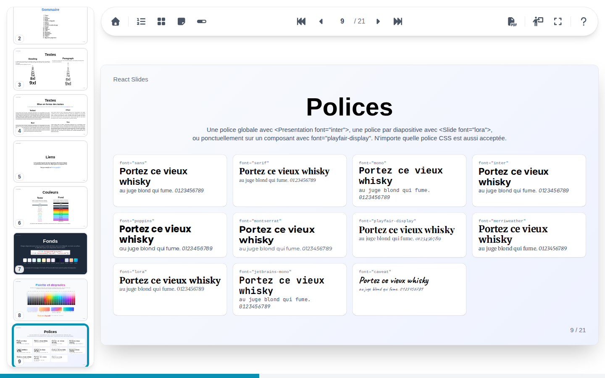
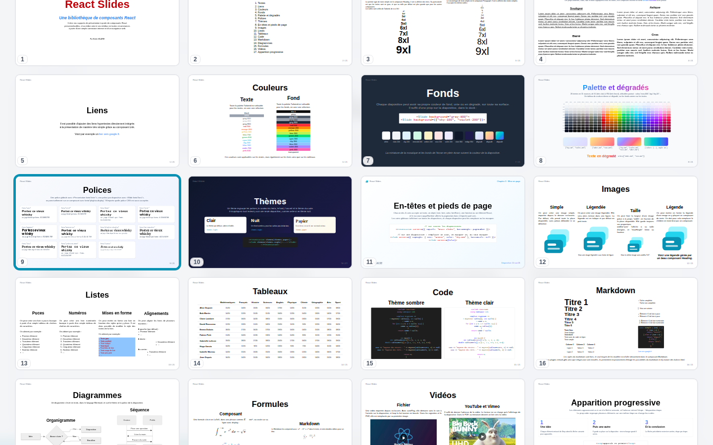

# Liste des diapositives et mosaïque

Deux vues d'ensemble montrent toutes les diapositives d'un coup. Leurs miniatures ne se dessinent qu'à proximité de la partie visible du panneau : même une présentation de plusieurs centaines de diapositives défile sans à-coup.

## Liste des diapositives

La liste des diapositives s'ouvre à gauche, par son bouton ou ++s++. Elle met en valeur la diapositive en cours ; cliquez sur une miniature pour y aller. Sur un grand écran, elle reste ouverte à côté de la diapositive ; ailleurs, elle se ferme une fois la diapositive choisie.

## Mosaïque

La mosaïque couvre tout l'écran d'une grille de toutes les diapositives, par son bouton ou ++m++.

| Touches | Action |
| --- | --- |
| Flèches | Déplacer la sélection, la diapositive en cours la suit |
| ++enter++ | Fermer la mosaïque sur la diapositive sélectionnée |
| ++esc++ | Fermer la mosaïque |

Cliquez sur une miniature pour l'ouvrir, ou n'importe où ailleurs pour fermer la mosaïque.

Les miniatures montrent chaque diapositive avec toutes ses étapes. Une vidéo y apparaît par sa première image, avec un signe lecture.
