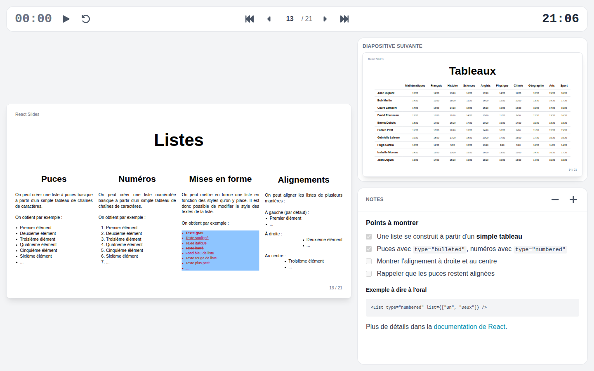

# Vue présentateur

La vue présentateur affiche sur l'écran de l'orateur ce que le public ne voit pas : la diapositive en cours, l'étape ou la diapositive suivante, les notes, un chronomètre et l'heure.

## La lancer

Le bouton présentateur de la barre d'outils, ou ++v++, ouvre la vue présentateur dans une fenêtre à part.

- **Dans Chrome ou Edge avec deux écrans**, la présentation passe en plein écran sur l'autre écran, pour le public, et la vue présentateur s'ouvre sur l'écran utilisé. Le navigateur demande une fois l'autorisation de placer les fenêtres.
- **Ailleurs**, ou avec un seul écran, la vue présentateur s'ouvre dans une nouvelle fenêtre : déplacez la fenêtre de la présentation sur le projecteur et appuyez sur ++f++.

## S'en servir

- La navigation de la vue présentateur est la même que celle de la barre d'outils, touches comprises ; un clic sur la diapositive en cours avance aussi. Les deux fenêtres montrent toujours la même diapositive et la même étape, quelle que soit celle qui avance.
- Le chronomètre attend à zéro qu'on le lance avec son bouton lecture, puis se met en pause, reprend ou se remet à zéro.
- Les boutons moins et plus changent la taille des notes ; le choix est retenu.

Seules ces deux fenêtres se suivent : un autre onglet de la même présentation reste où il est.

## La terminer

Sortir du plein écran sur la présentation ferme la vue présentateur, et fermer la vue présentateur sort la présentation du plein écran.

Le bouton présentateur n'apparaît qu'avec une souris, quand la barre d'outils est assez large, hors plein écran.
