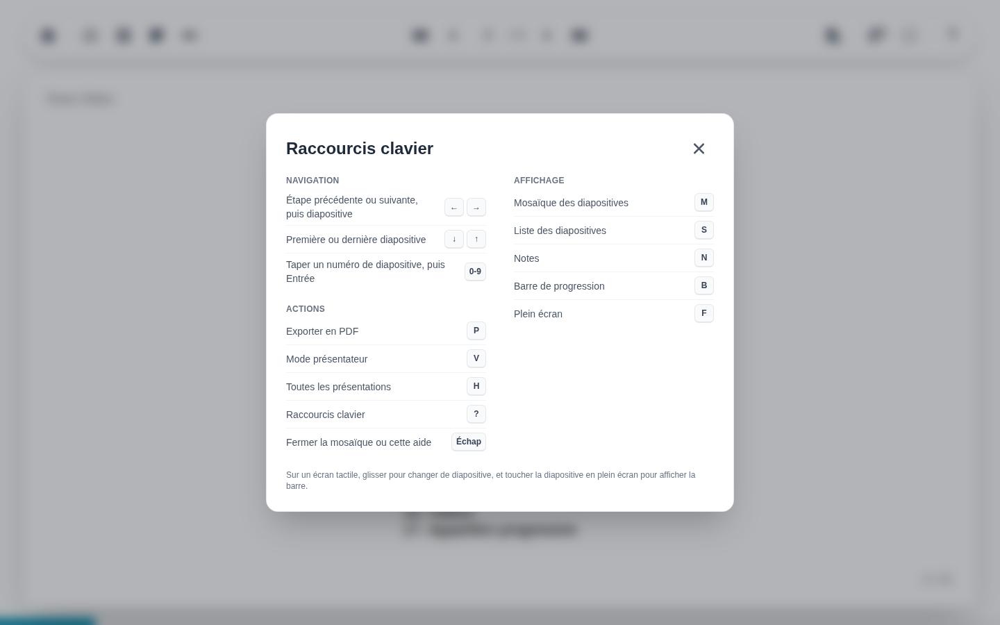

# Raccourcis clavier

Le bouton point d'interrogation tout à droite de la barre d'outils, ou <kbd>?</kbd>, liste les raccourcis clavier.

| Touches | Action |
| --- | --- |
| ++arrow-left++ ++arrow-right++ | Étape précédente ou suivante, puis diapositive (aussi ++page-up++ et ++page-down++) |
| ++arrow-down++ ++arrow-up++ | Première et dernière diapositive |
| ++0++ à ++9++ | Taper un numéro de diapositive, puis ++enter++ |
| ++m++ | Mosaïque |
| ++s++ | Liste des diapositives |
| ++n++ | Notes |
| ++b++ | Barre de progression |
| ++f++ | Plein écran |
| ++p++ | Export PDF |
| ++v++ | Vue présentateur |
| ++h++ | Retour à la page d'accueil |
| <kbd>?</kbd> | Cette aide |
| ++esc++ | Fermer la mosaïque ou l'aide |

Chaque raccourci appartient à un bouton, et ne fonctionne que quand son bouton est affiché : pas de bouton, pas de raccourci. En plein écran, par exemple, ++p++ et ++m++ ne font rien, leurs boutons étant masqués. L'aide ne liste que les raccourcis disponibles au moment où elle s'ouvre.

Le bouton point d'interrogation est masqué sur les écrans sans souris.
